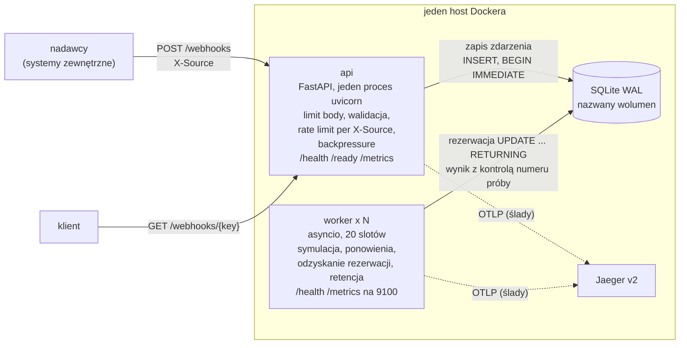
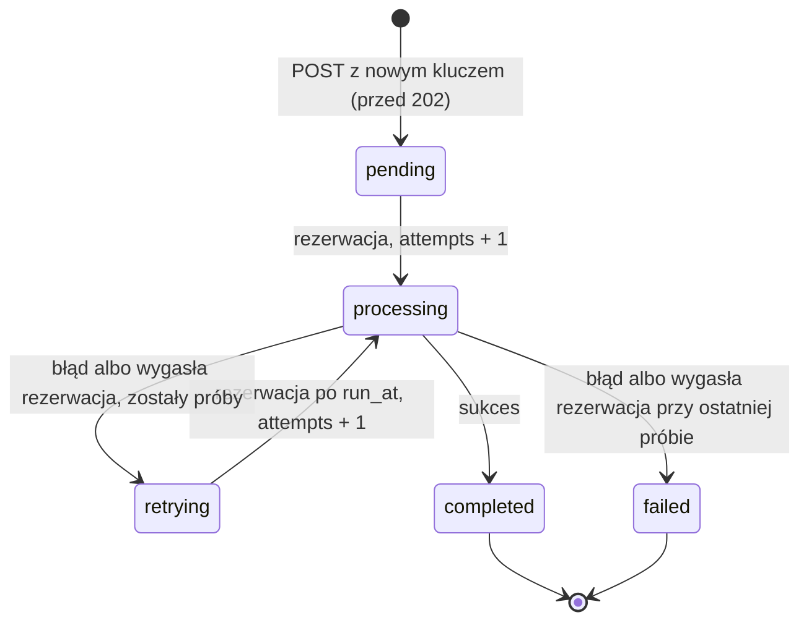

# Webhook Receiver

[](https://github.com/pksiazek/zadanie-webhook-receiver/actions/workflows/ci.yml)

Prototyp serwisu HTTP, który przyjmuje webhooki JSON z `idempotency_key`,
gwarantuje ich przetworzenie (także po restarcie lub awarii procesu) i
udostępnia status każdego zdarzenia. Rozwiązanie
[zadania rekrutacyjnego](https://gist.github.com/kaluzaaa/fcd035829013d9952f71a9a6a59a4d2f#file-gist_webhook_receiver-md).

Python 3.14, FastAPI, SQLite (WAL) jako magazyn **i** kolejka, osobne
procesy `api` i `worker`, OpenTelemetry (ślady do Jaegera, metryki
Prometheus, logi JSON). Zrealizowane wszystkie punkty bonusowe: testy
jednostkowe, rate limiting, metryki i health/readiness, ponawianie prób,
test obciążeniowy i benchmarki.

## Spis treści

- [W skrócie](#w-skrócie)
- [Architektura](#architektura)
- [Co naprawdę gwarantujemy („dokładnie raz”)](#co-naprawdę-gwarantujemy-dokładnie-raz)
- [Uruchomienie](#uruchomienie)
- [Przykłady: webhooki z treści zadania](#przykłady-webhooki-z-treści-zadania)
- [API](#api)
- [Statusy zdarzenia](#statusy-zdarzenia)
- [Konfiguracja](#konfiguracja)
- [Obserwowalność](#obserwowalność)
- [SQLite dla operatora](#sqlite-dla-operatora)
- [Testy, test obciążeniowy, benchmarki](#testy-test-obciążeniowy-benchmarki)
- [Wyniki](#wyniki)
- [Założenia skalowalności](#założenia-skalowalności)
- [Tradeoffy](#tradeoffy)
- [TODO](#todo)
- [Struktura repozytorium i dokumenty](#struktura-repozytorium-i-dokumenty)

## W skrócie

| Pytanie | Odpowiedź |
|---|---|
| Jak uruchomić? | `docker compose up -d --build --wait` → API na `localhost:8000`, Jaeger na `localhost:16686` ([szczegóły](#uruchomienie)) |
| Czy zdarzenie po `202` może zginąć? | Nie: `202` dopiero po `COMMIT` z `synchronous=FULL` (fsync); worker, który padnie, traci rezerwację i zdarzenie podejmuje inny ([gwarancje](#co-naprawdę-gwarantujemy-dokładnie-raz)) |
| Czy duplikat jest przetwarzany ponownie? | Nie: `UNIQUE(idempotency_key)`, duplikat dostaje `200` z aktualnym statusem |
| Czy „dokładnie raz” jest prawdą? | Zapis zdarzenia i zapis wyniku — dokładnie raz; samo wykonanie — co najmniej raz ([dlaczego](#co-naprawdę-gwarantujemy-dokładnie-raz)) |
| Czy wytrzymuje 1000 webhooków/min? | Tak: p99 `POST` 19,3 ms przy 1000/min, 17,0 ms przy 3000/min; przetwarzanie skaluje się liniowo z liczbą workerów (99,8–99,9%) ([wyniki](#wyniki)) |
| Gdzie są kompromisy i braki? | [Tradeoffy](#tradeoffy) i [TODO](#todo) |

## Architektura

Wybrane podejście: **osobne procesy `api` i `worker`, wspólny kod i jeden
plik SQLite, który jest jednocześnie magazynem i kolejką**. Wiersz ze
statusem `pending` *jest* zadaniem — zapisanym w tej samej transakcji co
zdarzenie, więc nie ma problemu podwójnego zapisu (baza + broker).



- **api** przyjmuje webhooki, zapisuje je i odpowiada `202`; nie wykonuje
  przetwarzania, więc rosnąca kolejka nie wydłuża odpowiedzi na `POST`.
- **worker** (domyślnie 3 kontenery × 20 slotów asyncio) atomowo rezerwuje
  porcję należnych zdarzeń, symuluje przetwarzanie (`sleep` 2–5 s), zapisuje
  wynik albo planuje ponowienie z wykładniczym odstępem. Dobiera pracę od
  razu po zwolnieniu slotu; co `POLL_INTERVAL_SECONDS` (0,5 s) sprawdza
  kolejkę, gdy nic nie było do pobrania.
- **Ślad** obejmuje drogę od `POST` do wyniku mimo granicy procesów: API
  zapisuje W3C `traceparent` w wierszu zdarzenia, worker odtwarza z niego
  kontekst i tworzy jeden span `webhook.process` na każdą próbę.
- Odrzucone alternatywy: jeden proces z pulą asyncio (API i przetwarzanie
  dzielą pętlę zdarzeń i los, brak niezależnego skalowania) oraz broker
  (Redis/Celery — zadanie narzuca SQLite, podwójny zapis wymaga outboxa).
  Pełne porównanie: [dokument projektowy §5](docs/superpowers/specs/2026-10-25-webhook-receiver-design.md#5-wybrane-podejście).

## Co naprawdę gwarantujemy („dokładnie raz”)

Dokładnie-raz end-to-end nie jest możliwe bez współpracy samego efektu
ubocznego. Serwis gwarantuje:

| Co | Gwarancja | Mechanizm |
|---|---|---|
| Zapis zdarzenia | **dokładnie raz** | `UNIQUE(idempotency_key)`; `INSERT … ON CONFLICT DO NOTHING RETURNING` — zapis i decyzja „nowe/duplikat” w jednej transakcji `BEGIN IMMEDIATE`; `202` dopiero po `COMMIT` z `synchronous=FULL` |
| Wykonanie przetwarzania | **co najmniej raz** | worker rezerwuje zdarzenie na `LEASE_SECONDS` (30 s); jeśli padnie, rezerwacja wygasa, inny worker ją odzyskuje (`retrying`, `last_error = "lease expired"`) i wykonuje kolejną próbę |
| Efekt (zapis wyniku) | **dokładnie raz** | zapis warunkowy: `UPDATE … WHERE id = ? AND status = 'processing' AND attempts = ?`; każda rezerwacja zwiększa `attempts`, więc spóźniony worker z wygasłą rezerwacją ma nieaktualny numer próby — jego zapis nie trafia w żaden wiersz i jest odrzucany (log `stale_result`, metryka `webhook_stale_results_total`) |

Założenie: prawdziwy efekt uboczny (zamiast symulacji) musiałby być
idempotentny względem `idempotency_key` — bo wykonanie może się powtórzyć,
gdy worker padnie po wykonaniu, a przed zapisem wyniku.

**Restart lub awaria API:**

- **między `COMMIT` a wysłaniem `202`** — klient nie dostaje odpowiedzi i
  ponawia; ponowienie trafia na istniejący klucz i dostaje `200` z aktualnym
  statusem. Zdarzenie nie ginie i nie jest przetwarzane dwa razy;
- **przed `COMMIT`** — nic nie zostało zapisane, ponowienie zapisuje
  zdarzenie jako nowe (`202`).

**Restart lub awaria workera:** zdarzenia w `processing` czekają na
wygaśnięcie rezerwacji (do 30 s), potem są odzyskiwane. Graceful shutdown
(SIGTERM) przestaje pobierać pracę i czeka na trwające próby do
`SHUTDOWN_GRACE_SECONDS` (10 s); `stop_grace_period: 20s` w compose
pilnuje, żeby Docker nie zabił workera wcześniej.

Granica ochrony przed duplikatami to retencja: po usunięciu wiersza (30 dni
od zakończenia) ten sam klucz zostanie przyjęty jako nowe zdarzenie
([retencja](#retencja-dwa-progi-gdpr-plik-nie-maleje)).

Demonstracja awarii workera (stos z sekcji [Docker](#docker-dowolny-host)):

```bash
curl -s -X POST localhost:8000/webhooks -H 'Content-Type: application/json' \
  -H 'X-Source: shop' \
  -d '{"idempotency_key": "evt-crash", "event_type": "demo.crash", "payload": {}}'
sleep 1
docker compose kill worker        # SIGKILL wszystkich workerów w trakcie próby
curl -s localhost:8000/webhooks/evt-crash   # "status":"processing","attempts":1
docker compose start worker
sleep 35                          # rezerwacja (30 s) wygasa, zdarzenie odzyskane
curl -s localhost:8000/webhooks/evt-crash   # "status":"completed","attempts":2
docker compose logs worker | grep lease_recovered
```

Restart API nie wpływa na zapisane zdarzenia:

```bash
docker compose restart api && docker compose up -d --wait
curl -s localhost:8000/webhooks/evt-crash   # nadal "completed"
```

## Uruchomienie

### Docker (dowolny host)

Wymagania: Docker Engine z Compose v2 (Linux, macOS z Docker
Desktop/OrbStack, Windows z WSL2). Obraz bazowy `python:3.14-slim-trixie`
jest wieloarchitekturowy (amd64, arm64); baza leży na nazwanym wolumenie,
bez bind mountów.

```bash
docker compose up -d --build --wait   # api + 3 workery + Jaeger
docker compose ps                     # api i workery: (healthy)
curl -s localhost:8000/ready          # {"status":"ready"}
```

| Usługa | Adres | Uwagi |
|---|---|---|
| API | `http://localhost:8000` | port hosta: zmienna `API_PORT` (np. `API_PORT=8080 docker compose up -d`) |
| Jaeger UI | `http://localhost:16686` | port hosta: zmienna `JAEGER_UI_PORT` |
| worker `/health`, `/metrics` | port 9100 tylko w sieci compose | celowo niepublikowany — `--scale` nie koliduje o port |

**Skalowanie workerów** (domyślnie `deploy.replicas: 3`):

```bash
docker compose up -d --wait --scale worker=5
docker compose ps worker              # 5 kontenerów (healthy)
```

Zatrzymanie: `docker compose down` (dane zostają na wolumenie
`webhook-data`) albo `docker compose down -v` (także dane).

Wszystkie kontenery mają `restart: unless-stopped`. Konsekwencja: błąd
konfiguracji przy starcie (np. `LEASE_SECONDS` ≤ `SIMULATED_MAX_SECONDS`)
daje **pętlę restartów**, widoczną w `docker compose ps` (status
`Restarting`) i w `docker compose logs <usługa>` (błąd walidacji
konfiguracji).

### Lokalnie (uv)

Wymagania: Python 3.14 i [uv](https://docs.astral.sh/uv/). Tryb
`EMBEDDED_WORKER=true` uruchamia worker w procesie API — wyłącznie dla
wygody developmentu (bez Dockera, jeden proces).

```bash
uv sync --extra dev
EMBEDDED_WORKER=true uv run python -m webhook_receiver api
```

- Baza: `data/webhooks.db` (zmienna `DB_PATH`), API na porcie 8000
  (`API_PORT`).
- Bez `OTEL_EXPORTER_OTLP_ENDPOINT` spany są wypisywane na stderr (logi
  JSON idą na stdout); `OTEL_TRACES_EXPORTER=none` je wyłącza.
- W tym trybie nie startuje serwer pomocniczy workera (9100), a metryki
  workera trafiają na `/metrics` API.
- Jeśli wbudowany worker ulegnie awarii, **API dalej przyjmuje webhooki**
  (świadoma decyzja: przyjmowanie nie zależy od przetwarzania). Awaria jest
  logowana od razu (`"event": "embedded_worker_crashed"`), a brak postępu
  widać po rosnącym `webhook_queue_oldest_pending_age_seconds`.
- Osobne procesy bez Dockera: `uv run python -m webhook_receiver api` i w
  drugim terminalu `uv run python -m webhook_receiver worker` (ten sam
  `DB_PATH`).

### Devcontainer

Repozytorium zawiera devcontainer (`mcr.microsoft.com/devcontainers/python:3.14-trixie`)
z funkcją **docker-in-docker**: osobny demon Dockera wewnątrz kontenera,
bez dostępu do demona i plików hosta. W nim powstały wszystkie wyniki z
[sekcji Wyniki](#wyniki); polecenia `docker compose …` działają tak samo jak
na „gołym” hoście, porty 8000 i 16686 są przekazywane do hosta. Devcontainer
ma też `sqlite3` CLI (patrz [SQLite dla operatora](#sqlite-dla-operatora)).

## Przykłady: webhooki z treści zadania

Pięć przykładowych webhooków z treści zadania, dosłownie (stos z sekcji
[Docker](#docker-dowolny-host) albo tryb lokalny):

```bash
H='Content-Type: application/json'

curl -s -X POST localhost:8000/webhooks -H "$H" -H 'X-Source: shop' -d '{
  "idempotency_key": "evt-001",
  "event_type": "order.created",
  "payload": {"order_id": "ORD-2024-1234", "customer": "Jan Kowalski",
              "amount": 299.99, "currency": "PLN"}}'

curl -s -X POST localhost:8000/webhooks -H "$H" -H 'X-Source: shop' -d '{
  "idempotency_key": "evt-002",
  "event_type": "order.paid",
  "payload": {"order_id": "ORD-2024-1234", "payment_method": "card",
              "paid_at": "2024-12-01T14:30:00Z"}}'

curl -s -X POST localhost:8000/webhooks -H "$H" -H 'X-Source: shop' -d '{
  "idempotency_key": "evt-003",
  "event_type": "order.shipped",
  "payload": {"order_id": "ORD-2024-1234", "tracking_number": "PL1234567890",
              "carrier": "DPD"}}'

curl -s -X POST localhost:8000/webhooks -H "$H" -H 'X-Source: crm' -d '{
  "idempotency_key": "evt-004",
  "event_type": "user.registered",
  "payload": {"user_id": "USR-9876", "email": "jan@example.com"}}'

curl -s -X POST localhost:8000/webhooks -H "$H" -H 'X-Source: payments' -d '{
  "idempotency_key": "evt-005",
  "event_type": "payment.failed",
  "payload": {"order_id": "ORD-2024-5678", "reason": "insufficient_funds"}}'
```

Każde zwraca `202` z nagłówkiem `Location`:

```json
{"idempotency_key":"evt-001","status":"pending","status_url":"/webhooks/evt-001"}
```

Status (po 2–5 s `completed`):

```bash
curl -s localhost:8000/webhooks/evt-001
```

```json
{"idempotency_key":"evt-001","source":"shop","event_type":"order.created",
 "status":"completed","attempts":1,"max_attempts":5,"next_attempt_at":null,
 "last_error":null,
 "result":{"processed_by":"700e5b8a1962-7","duration_ms":3760,"attempt":1},
 "created_at":"2026-10-26T19:32:45.711Z","finished_at":"2026-10-26T19:32:49.546Z",
 "payload_purged":false}
```

**Duplikat** — ten sam klucz (treść nie jest porównywana): `200`,
aktualny status pierwotnego zdarzenia i `"duplicate": true`; nic nie jest
zapisywane ani przetwarzane ponownie.

```bash
curl -s -w ' HTTP %{http_code}\n' -X POST localhost:8000/webhooks -H "$H" \
  -H 'X-Source: shop' \
  -d '{"idempotency_key": "evt-001", "event_type": "order.created", "payload": {}}'
```

**Ponowienia** — deterministyczne wyzwalacze błędów w `payload.simulate`
(dodatek do przykładów z zadania):

```bash
# fail_once: próba 1 pada, próba 2 kończy się sukcesem
curl -s -X POST localhost:8000/webhooks -H "$H" -H 'X-Source: shop' \
  -d '{"idempotency_key": "evt-fail-once", "event_type": "demo",
       "payload": {"simulate": "fail_once"}}'
for i in $(seq 1 15); do
  curl -s localhost:8000/webhooks/evt-fail-once \
    | grep -o '"status":"[a-z]*","attempts":[0-9]*'
  sleep 1
done
# pending/0 → processing/1 → retrying/1 (last_error "simulated failure
# (fail_once)", odstęp ok. 2 s) → processing/2 → completed/2

# fail_always: każda próba pada; po MAX_ATTEMPTS=5 próbach status failed
curl -s -X POST localhost:8000/webhooks -H "$H" -H 'X-Source: shop' \
  -d '{"idempotency_key": "evt-fail-always", "event_type": "demo",
       "payload": {"simulate": "fail_always"}}'
sleep 65; curl -s localhost:8000/webhooks/evt-fail-always
# "status":"failed","attempts":5,"last_error":"simulated failure (fail_always)"
```

`fail_always` trwa ok. 35–60 s: 5 prób po 2–5 s plus odstępy ok. 2, 4, 8 i
16 s. Odstęp to `min(BACKOFF_BASE_SECONDS · 2^(attempts−1),
BACKOFF_MAX_SECONDS)` z losowym rozrzutem ±20%.

**Rate limiting** — 150 równoległych żądań z jednego źródła (kubełek: 100
żądań na start, potem 50/s):

```bash
seq 1 150 | xargs -P 20 -I@ curl -s -o /dev/null -w '%{http_code}\n' \
  -X POST localhost:8000/webhooks -H "$H" -H 'X-Source: flood' \
  -d '{"idempotency_key": "rl-@", "event_type": "demo", "payload": {}}' \
  | sort | uniq -c
# ok. 100–110 x 202, reszta 429 (z nagłówkiem Retry-After)
```

## API

### `POST /webhooks`

Nagłówki: `Content-Type: application/json`, **`X-Source`** (wymagany,
1–64 znaki). Body:

```json
{"idempotency_key": "evt-001", "event_type": "order.created", "payload": {"...": "..."}}
```

- `idempotency_key` — niepusty string, maks. 255 znaków, dowolne znaki;
  **globalnie unikalny** (nie w obrębie nadawcy).
- `event_type` — niepusty string; `payload` — obiekt JSON; inne pola są
  ignorowane.
- Limit body: 256 KiB (`MAX_BODY_BYTES`), sprawdzany na `Content-Length` i
  przy czytaniu strumienia (żądania chunked).

| Sytuacja | Kod | Uwagi |
|---|---|---|
| nowe zdarzenie, zapisane trwale | `202` | `{idempotency_key, status: "pending", status_url}` + nagłówek `Location` (klucz zakodowany procentowo) |
| duplikat (ten sam klucz, dowolna treść) | `200` | aktualny status jak w `GET` + `"duplicate": true`; także przy przekroczonym progu zaległości |
| body > 256 KiB | `413` | odrzucane przez middleware przed jakąkolwiek inną pracą; **nie jest liczone** w `webhooks_received_total` |
| brak lub zbyt długi `X-Source` | `400` | |
| niepoprawne body | `422` | lista błędów bez treści zgłoszenia |
| przekroczony limit nadawcy | `429` + `Retry-After` | duplikaty też zużywają limit |
| przekroczony próg zaległości (`pending`+`retrying` ≥ `MAX_BACKLOG`, domyślnie 100 000) | `503` + `Retry-After` | tylko nowe zdarzenia; duplikat dostaje `200` — nie dodaje pracy, a nadawca w pętli ponowień nie pogłębia zalewu |
| chwilowa rywalizacja o zapis w SQLite (`SQLITE_BUSY`/`SQLITE_LOCKED` po `busy_timeout` 5 s) | `503` + `Retry-After` | także duplikat — jego status nie jest wtedy znany; bez treści błędu bazy |
| inny błąd bazy (I/O, uszkodzony plik) | `500` | |

`Retry-After` dla obu `503`: `BACKPRESSURE_RETRY_AFTER_SECONDS` (5 s); dla
`429`: czas do odnowienia jednego żetonu (min. 1 s).

**Kolejność kontroli:** `413` (rozmiar) → `400` (`X-Source`) → `422`
(walidacja body) → `429` (rate limit) → `503` (backpressure; najpierw
sprawdzenie, czy to duplikat) → zapis zdarzenia (`202` / `200`; przy
rywalizacji o blokadę `503`).

**Rate limiting per `X-Source`.** Token bucket w pamięci procesu API:
`RATE_LIMIT_PER_SECOND` = 50 żądań/s, `RATE_LIMIT_BURST` = 100 na źródło.
`X-Source` jest wymagany właśnie dlatego — limit liczony jest per nadawca,
więc nadawcę trzeba znać; dodatkowo służy jako etykieta w metrykach, logach
i śladach. Nie jest częścią tożsamości zdarzenia: w wierszu zapisywane jest
źródło pierwszego zgłoszenia, ponowienie z innego źródła to zwykły
duplikat. Kubełki trzyma LRU ograniczone do `RATE_LIMIT_MAX_SOURCES`
(10 000) źródeł, żeby dowolne wartości nagłówka nie powiększały pamięci bez
końca. Konsekwencja: przy ponad 10 000 aktywnych źródeł najdawniej używany
kubełek jest usuwany, a jego źródło wraca z pełnym kubełkiem (burst) — przy
celowym zalewie losowymi `X-Source` limit per źródło przestaje chronić.
Limit działa w obrębie jednego procesu API (patrz
[jeden proces uvicorn](#jeden-proces-uvicorn)).

### `GET /webhooks/{idempotency_key}`

Nie wymaga `X-Source`. Klucz w ścieżce kodowany procentowo (RFC 3986), np.
`evt/1` → `/webhooks/evt%2F1` — tak samo jak w `Location` i `status_url`.
Nieznany klucz → `404`.

| Pole | Znaczenie |
|---|---|
| `status` | `pending`, `processing`, `retrying`, `completed`, `failed` ([statusy](#statusy-zdarzenia)) |
| `attempts` / `max_attempts` | wykonane próby / limit z konfiguracji (`MAX_ATTEMPTS`) |
| `next_attempt_at` | termin kolejnej próby dla `pending`/`retrying`, inaczej `null` |
| `last_error` | błąd ostatniej nieudanej próby (`simulated failure (…)`, `lease expired`) |
| `result` | wynik (`processed_by`, `duration_ms`, `attempt`) albo `null` |
| `created_at`, `finished_at` | ISO 8601 UTC; `finished_at` dla `completed`/`failed` |
| `payload_purged` | `true`, gdy retencja wyczyściła payload i wynik |

### Endpointy operacyjne

| Endpoint | Proces | Znaczenie |
|---|---|---|
| `GET /health` | api | liveness: proces odpowiada |
| `GET /ready` | api | readiness: baza odpowiada na zapytanie i schemat istnieje; inaczej `503` z listą `failed`. **Nie zależy od workerów** ([dlaczego](#readiness-api-niezależne-od-workera)) |
| `GET /metrics` | api | Prometheus, w tym gauge'e kolejki |
| `GET /health` (port 9100) | worker | pętla workera działa i wykonała obrót w ciągu ostatnich 10 × `POLL_INTERVAL_SECONDS`; używany przez healthcheck Dockera |
| `GET /metrics` (port 9100) | worker | metryki przetwarzania tego workera |

## Statusy zdarzenia



| Przejście | Kiedy dokładnie |
|---|---|
| → `pending` | w transakcji zapisu nowego zdarzenia, przed `202`; `run_at = now`, `attempts = 0` |
| `pending`/`retrying` → `processing` | worker atomowo rezerwuje porcję: jeden `UPDATE … WHERE id IN (SELECT id … WHERE status IN ('pending','retrying') AND run_at <= now ORDER BY run_at LIMIT k) RETURNING *`; `run_at = now + LEASE_SECONDS`, `attempts += 1` |
| `processing` → `completed` | sukces; zapis wyniku, statusu i `finished_at` jedną instrukcją z kontrolą numeru próby |
| `processing` → `retrying` | błąd i `attempts < MAX_ATTEMPTS`; `run_at = now + odstęp`, `last_error` zapisany |
| `processing` → `failed` | błąd przy `attempts = MAX_ATTEMPTS`; stan końcowy |
| `processing` → `retrying` / `failed` (odzyskanie rezerwacji) | `run_at <= now` przy `processing` — worker padł; `last_error = "lease expired"`; wykonywane przez każdy worker przed rezerwacją (`webhook_lease_recoveries_total`) |

`run_at` łączy dwa terminy (wzorzec „visibility timeout”, jak w SQS): dla
`pending`/`retrying` to moment, od którego wolno podjąć zdarzenie; dla
`processing` — moment wygaśnięcia rezerwacji.

## Konfiguracja

Zmienne środowiskowe (nazwa = pole `Settings` w
[`common/config.py`](src/webhook_receiver/common/config.py) wielkimi
literami). Konfiguracja jest walidowana przy starcie
(`LEASE_SECONDS > SIMULATED_MAX_SECONDS`, `SIMULATED_MIN_SECONDS ≤
SIMULATED_MAX_SECONDS`, `BACKOFF_MAX_SECONDS ≥ BACKOFF_BASE_SECONDS`).

| Zmienna | Domyślnie | Znaczenie |
|---|---|---|
| `DB_PATH` | `data/webhooks.db` (w obrazie `/data/webhooks.db`) | plik bazy |
| `API_PORT` | `8000` | port API |
| `EMBEDDED_WORKER` | `false` | worker w procesie API (development) |
| `MAX_ATTEMPTS` | `5` | liczba prób przed `failed` |
| `LEASE_SECONDS` | `30` | czas rezerwacji |
| `BACKOFF_BASE_SECONDS` / `BACKOFF_MAX_SECONDS` | `2` / `60` | odstęp ponowień |
| `WORKER_CONCURRENCY` | `20` | sloty na worker |
| `POLL_INTERVAL_SECONDS` | `0.5` | odpytywanie przy pustej kolejce |
| `SHUTDOWN_GRACE_SECONDS` | `10` | czas na dokończenie prób po SIGTERM |
| `SIMULATED_MIN_SECONDS` / `SIMULATED_MAX_SECONDS` | `2` / `5` | czas symulacji |
| `RATE_LIMIT_PER_SECOND` / `RATE_LIMIT_BURST` | `50` / `100` | limit per `X-Source` |
| `RATE_LIMIT_MAX_SOURCES` | `10000` | rozmiar LRU kubełków |
| `MAX_BACKLOG` | `100000` | próg backpressure |
| `BACKPRESSURE_RETRY_AFTER_SECONDS` | `5` | `Retry-After` dla `503` |
| `QUEUE_STATS_REFRESH_SECONDS` | `1` | odświeżanie cache statystyk kolejki |
| `MAX_BODY_BYTES` | `262144` | limit body |
| `RETENTION_INTERVAL_SECONDS` | `600` | co ile worker uruchamia retencję |
| `RETENTION_PAYLOAD_DAYS` | `7` | czyszczenie payloadu i wyniku `completed` |
| `RETENTION_COMPLETED_DAYS` / `RETENTION_FAILED_DAYS` | `30` / `30` | usuwanie wierszy |
| `RETENTION_BATCH_SIZE` | `1000` | wierszy na transakcję retencji |
| `WORKER_METRICS_PORT` | `9100` | serwer pomocniczy workera |
| `LOG_LEVEL` | `INFO` | poziom logów |

OpenTelemetry: `OTEL_EXPORTER_OTLP_ENDPOINT` przełącza eksport śladów na
OTLP/HTTP (w compose `http://jaeger:4318`); `OTEL_TRACES_EXPORTER`
(`otlp`, `console`, `none`) wybiera eksporter jawnie. `OTEL_SERVICE_NAME`
**nie jest uwzględniany** — nazwy usług (`webhook-api`, `webhook-worker`)
są ustawione w kodzie (→ [TODO](#todo)).

## Obserwowalność

### Metryki

API (`curl -s localhost:8000/metrics | grep ^webhook`):

| Metryka | Znaczenie |
|---|---|
| `webhooks_received_total{source, outcome}` | `outcome` = `accepted`, `duplicate`, `rate_limited`, `backpressure`, `db_busy`, `invalid`; `413` nie jest liczone |
| `webhook_queue_depth{status}` | liczba zdarzeń `pending`, `retrying`, `processing` (stanów końcowych nie liczymy — wymagałoby to skanu tabeli) |
| `webhook_queue_oldest_pending_age_seconds` | wiek najstarszej pracy **należnej i niepodjętej** (`pending`/`retrying` z `run_at <= now` oraz `processing` z wygasłą rezerwacją); liczony od `run_at`, więc odstęp ponowienia nie daje fałszywych alarmów. Z działającymi workerami ≈ 0; bez workerów rośnie liniowo — **najważniejszy sygnał „nikt nie przetwarza”** |

Gauge'e czytają cache odświeżany co ~1 s (ten sam, którego używa
backpressure), więc scrape nie wykonuje zapytań do bazy.

Worker (port 9100 w sieci compose; w trybie `EMBEDDED_WORKER` na
`/metrics` API):

| Metryka | Znaczenie |
|---|---|
| `webhook_attempts_total{outcome}` | `success`, `retry`, `failed` |
| `webhook_processing_duration_seconds{outcome}` | histogram czasu próby |
| `webhook_lease_recoveries_total` | odzyskane rezerwacje (po awarii workera) |
| `webhook_stale_results_total` | wyniki odrzucone przez kontrolę numeru próby |

Liczniki pojawiają się na `/metrics` dopiero po pierwszym zdarzeniu danego
rodzaju. Metryki workera odczytuje się per kontener:

```bash
docker compose exec --index 1 worker python -c \
  "import urllib.request; print(urllib.request.urlopen('http://localhost:9100/metrics').read().decode())" \
  | grep ^webhook
```

### Ślady (Jaeger)

Compose zawiera Jaeger v2 (`jaegertracing/jaeger:2.22.0`); API i workery
eksportują ślady przez OTLP. UI: <http://localhost:16686>, usługi
`webhook-api` i `webhook-worker`. Jeden ślad zawiera span `POST /webhooks`
i jako jego dzieci spany `webhook.process` — po jednym na każdą próbę
(atrybuty `attempt`, `idempotency_key`, `source`, `event_type`,
`worker.id`, `outcome`; nigdy payload). Spany `/health`, `/ready` i
`/metrics` są wyłączone.

API Jaegera v2 jest pod `/api/v3/…` (stare `/api/services` daje `404`):

```bash
curl -s localhost:16686/api/v3/services
# {"services":["webhook-api","webhook-worker"]}
```

Ślad konkretnego zdarzenia: identyfikator śladu to znaki 4–35 kolumny
`traceparent` (format W3C `00-<trace_id>-<span_id>-01`), więc link do UI
daje zapytanie
`SELECT 'http://localhost:16686/trace/' || substr(traceparent, 4, 32) FROM webhook_events WHERE idempotency_key = 'evt-001';`
([jak uruchomić zapytanie](#sqlite-dla-operatora)).

### Logi

Strukturalny JSON na stdout (spany eksportera konsolowego, jeśli włączony,
na stderr). Każdy wpis ma `trace_id` i `span_id` (do wyszukania w
Jaegerze), a wpisy o zdarzeniach także `event` oraz — zależnie od rodzaju —
`idempotency_key`, `source`, `worker_id`, `attempt`; wartości `event`:
`accepted`, `duplicate`, `rate_limited`, `backpressure`, `db_busy`,
`invalid`, `claimed`, `attempt`, `lease_recovered`, `stale_result`,
`retention`. Payload i wynik nigdy nie trafiają do logów.

```bash
docker compose logs --no-log-prefix api | grep '"idempotency_key": "evt-001"'
docker compose logs --no-log-prefix worker | grep '"event": "lease_recovered"'
```

### Ile workerów działa

API nie śledzi workerów (brak tabeli heartbeatów — świadoma decyzja), więc
liczby workerów nie widać w żadnej metryce API. Źródła:

1. **`docker compose ps worker`** — liczba kontenerów workera w stanie
   `(healthy)`; healthcheck odpytuje `/health` workera co 5 s.
2. `/health` konkretnego workera:
   ```bash
   docker compose exec --index 2 worker python -c \
     "import urllib.request; print(urllib.request.urlopen('http://localhost:9100/health').read())"
   ```
3. Pod obciążeniem `webhook_queue_depth{status="processing"}` ≈ liczba
   workerów × 20 (w teście `steady` i `burst`: 60 przy 3 workerach).
4. `webhook_queue_oldest_pending_age_seconds` rosnący mimo „zdrowych”
   kontenerów = workery nie nadążają albo nie przetwarzają.
5. Rozkład pracy między workery w bazie: zapytanie po
   `json_extract(result_json, '$.processed_by')` w następnej sekcji.

## SQLite dla operatora

**W devcontainerze** (jest `sqlite3` CLI; plik wolumenu należy do roota
demona docker-in-docker). Tryb `mode=ro` — tylko odczyt:

```bash
DB="$(docker volume inspect -f '{{ .Mountpoint }}' zadanie-webhook-receiver_webhook-data)/webhooks.db"
sudo sqlite3 -header -box "file:$DB?mode=ro" \
  "SELECT status, COUNT(*) FROM webhook_events GROUP BY status;"
```

**Na dowolnym hoście** (bez `sqlite3` na hoście; na macOS wolumen jest w
maszynie wirtualnej) — moduł `sqlite3` Pythona w kontenerze. Obsługuje SQL,
ale z poleceń z kropką tylko `.help` i `.quit`:

```bash
docker compose exec api python -m sqlite3 /data/webhooks.db \
  "SELECT status, COUNT(*) FROM webhook_events GROUP BY status"
```

Zapytania (czasy w bazie to INTEGER, ms od epoki — podgląd przez
`datetime(col/1000, 'unixepoch')`):

```sql
-- zdarzenia failed
SELECT idempotency_key, source, event_type, attempts, last_error,
       datetime(finished_at/1000, 'unixepoch') AS finished
FROM webhook_events WHERE status = 'failed' ORDER BY finished_at DESC;

-- zaległe: należne i niepodjęte (pending/retrying po terminie)
SELECT idempotency_key, status, attempts, last_error,
       datetime(run_at/1000, 'unixepoch') AS due,
       datetime(created_at/1000, 'unixepoch') AS created
FROM webhook_events
WHERE status IN ('pending', 'retrying')
  AND run_at <= CAST(unixepoch('subsec') * 1000 AS INTEGER)
ORDER BY run_at LIMIT 50;

-- wygasłe rezerwacje (worker padł, czeka na odzyskanie)
SELECT idempotency_key, attempts, datetime(run_at/1000, 'unixepoch') AS lease_expired
FROM webhook_events
WHERE status = 'processing'
  AND run_at <= CAST(unixepoch('subsec') * 1000 AS INTEGER);

-- rozkład pracy między workery
SELECT json_extract(result_json, '$.processed_by') AS worker, COUNT(*)
FROM webhook_events WHERE status = 'completed' GROUP BY worker;

-- link do śladu w Jaegerze
SELECT 'http://localhost:16686/trace/' || substr(traceparent, 4, 32)
FROM webhook_events WHERE idempotency_key = 'evt-001';
```

**Spójna kopia bazy** do analizy poza produkcją — API kopii zapasowej
SQLite (bezpieczne przy działającym systemie):

```bash
sudo sqlite3 "file:$DB?mode=ro" ".backup /tmp/webhooks-copy.db"     # devcontainer
docker compose exec api python -c "import sqlite3; \
  sqlite3.connect('/data/webhooks.db').backup(sqlite3.connect('/tmp/copy.db'))"
docker compose cp api:/tmp/copy.db ./webhooks-copy.db              # dowolny host
```

**Uwaga:** nie otwieraj na żywej bazie długich transakcji zapisujących
(np. ręcznego `BEGIN; UPDATE …` bez szybkiego `COMMIT`). SQLite ma jednego
pisarza naraz: taka transakcja blokuje zapis zdarzeń, a po `busy_timeout`
(5 s) API zaczyna odpowiadać `503`, a workery logują `worker turn failed`.

## Testy, test obciążeniowy, benchmarki

**Testy i linter** (te same kroki co w CI):

```bash
uv sync --extra dev
uv run ruff check .
uv run ruff format --check .
uv run pytest            # unit + integration, pokrycie pakietu, próg 85%
```

Testy są deterministyczne (wstrzykiwany zegar, osobna baza na test) i
obejmują m.in. pięć webhooków z treści zadania, duplikaty, kody z tabeli
API, atomową rezerwację, kontrolę numeru próby, odzyskanie rezerwacji
(„restart”), retencję, propagację `traceparent` i plany zapytań
(`EXPLAIN QUERY PLAN` bez `SCAN` tabeli). CI (GitHub Actions) uruchamia
ruff, pytest z progiem pokrycia 85% i `docker build` obrazu.

**Test obciążeniowy** — generator asyncio + httpx z modelem otwartym (stałe
tempo napływu, niezależne od czasu odpowiedzi), 5 wartości `X-Source`,
uruchamiany jako kontener (profil compose `loadtest`), na świeżym stosie:

```bash
docker compose down -v && docker compose up -d --build --wait
docker compose run --rm -T loadtest steady > results/steady.txt   # ~3 min
docker compose down -v && docker compose up -d --build --wait
docker compose run --rm -T loadtest burst > results/burst.txt     # ~6–7 min
bash scripts/scaling.sh                                           # N = 1, 2, 3; ~10 min
```

Wszystkie tempa, czasy i progi to flagi (`docker compose run --rm loadtest
steady --help`). `scripts/scaling.sh` działa po stronie hosta (kontener
generatora celowo nie ma dostępu do Dockera): dla każdego N robi
`docker compose down -v`, `up --scale worker=N`, zalewa kolejkę i zapisuje
`results/scaling-N.json`, `results/scaling-N-observations.txt` oraz
`results/scaling-report.txt`. Próbny przebieg bez nadpisywania wyników:
`RESULTS_DIR=/tmp/scaling FLOOD_ARGS="--count 300 --warmup 2 --measure 10" bash scripts/scaling.sh 1`.

**Benchmarki SQLite** (ręcznie, poza CI — wyniki na współdzielonych
maszynach GitHuba są zbyt zaszumione), na nazwanym wolumenie jak baza
produkcyjna, ~10 min:

```bash
docker compose run --rm --no-deps -T -v bench-data:/data --entrypoint python \
  loadtest -W error -m benchmarks.sqlite_bench all --dir /data/bench --repeat 5 \
  > results/benchmarks.txt
docker volume rm bench-data        # wolumen spoza projektu compose
```

`--quick` uruchamia wersję dymną (małe rozmiary; wyniki bez wartości
pomiarowej).

## Wyniki

### Środowisko

Wszystkie pomiary ([`results/`](results/),
[`results/environment.txt`](results/environment.txt)): Apple Silicon,
10 rdzeni, 11 GiB RAM, maszyna wirtualna Linux OrbStack na macOS
(aarch64), devcontainer z docker-in-docker, Docker 29.9.2, Compose 2.40.3,
obraz `python:3.14-slim-trixie` (Python 3.14.9, SQLite 3.46.1), wolumen
nazwany na btrfs. Ślady eksportowane do Jaegera podczas pomiarów.
Topologia: api × 1, worker × 3 × `WORKER_CONCURRENCY=20` (`steady`,
`burst`); worker × N = 1, 2, 3 (`scaling`). Liczby dotyczą tej maszyny —
na innym sprzęcie, zwłaszcza innym dysku, będą inne.

### `steady` — 1000/min przez 3 min ([`results/steady.txt`](results/steady.txt))

| Faza | Czas | Żądania | p50 | p95 | p99 | max | Kody |
|---|---|---|---|---|---|---|---|
| przyjmowanie | 179,9 s | 3000 | 8,4 ms | 13,1 ms | 19,3 ms | 50,1 ms | `202`: 3000 |
| schodzenie kolejki | 7,1 s (limit 120 s) | — | | | | | |

Szczyt kolejki (`pending`+`retrying`): 9; `processing` przez cały czas
55–60 (3 × 20 slotów). Kompletność: wysłano 3000, `completed` 3000.
Kryteria (p99 < 100 ms, zero odpowiedzi innych niż 2xx, limity faz, każdy
klucz `completed`): **PASS**.

### `burst` — 3000/min, potem 100/min, potem cisza ([`results/burst.txt`](results/burst.txt))

| Faza | Czas (limit) | Żądania | p50 | p95 | p99 | max | Kody |
|---|---|---|---|---|---|---|---|
| 1: 3000/min | 120,0 s (120 s) | 6000 | 6,8 ms | 10,9 ms | 17,0 ms | 47,2 ms | `202`: 6000 |
| 2: 100/min do kolejki ≤ 100 | 249,0 s (600 s) | 416 | 9,7 ms | 14,4 ms | 20,0 ms | 30,7 ms | `202`: 416 |
| 3: 0/min do kolejki = 0 | 12,0 s (120 s) | 0 | | | | | |

Całość 381,0 s (limit 900 s). Kolejka rosła do **3904** (t = 121 s), a
potem spokojnie schodziła — netto ok. 150–175 zdarzeń na ~10 s mimo
napływu 100/min — przy stałych 60 zdarzeniach w `processing`; przez cały czas opóźnienie `POST` się nie
zmieniło (p99 wszystkich żądań 17,1 ms). Kompletność: 6416 / 6416
`completed`. **PASS**. To jest główny argument za architekturą B:
przyjmowanie nie zależy od tempa przetwarzania.

Opóźnienie planowania generatora (o ile później od planu wysłał żądanie)
wynosiło maks. 12,7 ms w `burst` i 7,1 ms w `steady` — zadane tempo było
utrzymane.

### `scaling` — przepustowość przetwarzania dla N workerów ([`results/scaling-report.txt`](results/scaling-report.txt))

Na czystej bazie: 3000 zdarzeń wysłanych tempem 200/s z 5 źródeł, potem
pomiar przez 120 s (okno 25–145 s) tempa kończenia zdarzeń.

| Workery (× 20 slotów) | Zdarzeń/min | Liniowo (N × wynik 1) | Liniowość | p99 `POST` | Wynik |
|---|---|---|---|---|---|
| 1 | 342,3 | 342,3 | 100,0% | 17,2 ms | PASS |
| 2 | 683,0 | 684,6 | 99,8% | 18,4 ms | PASS |
| 3 | 1025,8 | 1026,9 | 99,9% | 21,0 ms | PASS |

Kryterium ≥ 85% liniowości: **PASS** dla każdego N. Wyniki zgadzają się z
wyliczeniem 20 slotów / 3,5 s ≈ 340/min na worker. W logach workerów przy
każdym N: 0 × `database is locked`, 0 × `worker turn failed`, 0 ×
odzyskanych rezerwacji; CPU workera ok. 1–11% (`docker stats` w trakcie).
Przepustowość ogranicza tu liczba slotów, nie SQLite — patrz benchmark
rywalizacji poniżej.

### Benchmarki SQLite ([`results/benchmarks.txt`](results/benchmarks.txt))

Koszt pojedynczych operacji w izolacji, kod produkcyjny (`connect()`,
`EventRepository`), plik na dysku, 5 powtórzeń. W wierszach z n = 5 p95 =
maksimum.

**1. `synchronous=FULL` vs `NORMAL`** — transakcja zapisu zdarzenia
(`insert_or_get`):

| Tryb | Tempo | mediana | p95 | p99 |
|---|---|---|---|---|
| FULL | bez przerw (2171 tx/s seryjnie) | 0,419 ms | 0,624 ms | 0,915 ms |
| FULL | 100 tx/s | **2,059 ms** | 3,084 ms | 5,496 ms |
| NORMAL | bez przerw (20790 tx/s seryjnie) | 0,024 ms | 0,062 ms | 0,115 ms |
| NORMAL | 100 tx/s | 0,206 ms | 0,308 ms | 0,459 ms |

Realistyczny koszt to wiersz z tempem 100 tx/s: **ok. 2 ms na zapis** z
fsync (bez przerw zapisy korzystają z „rozgrzanego” urządzenia, stąd
0,4 ms). `NORMAL` jest o rząd wielkości tańszy, a mimo to zostaje `FULL`
— uzasadnienie w [tradeoffach](#synchronousfull-zamiast-normal). Zastrzeżenie: w maszynie
wirtualnej OrbStack na macOS fsync może nie wymuszać zapisu na nośnik tak
jak `F_FULLFSYNC`, więc liczby dla `FULL` mogą być optymistyczne.

**2. Rezerwacja przy rosnącej kolejce** — `claim(20)`:

| Kolejka należnych | claim(20) mediana / p95 | samo zapytanie (bez `COMMIT`) | `COMMIT` mediana |
|---|---|---|---|
| 0 | 0,009 / 0,011 ms | 0,005 ms | 0,001 ms |
| 10 000 | 0,484 / 0,641 ms | 0,047 ms | 0,374 ms |
| 100 000 | 0,479 / 0,651 ms | 0,048 ms | 0,370 ms |

Koszt rezerwacji **nie zależy od długości kolejki** do 100 000 (= domyślny
`MAX_BACKLOG`): samo zapytanie to ok. 0,05 ms, reszta to commit z `FULL`.
Plan: `SEARCH … USING COVERING INDEX ix_events_ready`. `recover_expired`
kosztuje 0,009 ms (p95 0,012 ms), ale tylko gdy żadna rezerwacja nie wygasła
(60 ważnych rezerwacji, nic do zapisu); odzyskanie, które coś zapisuje,
płaci dodatkowo za commit.

**3. Rywalizacja o zapis** — 1/2/4/8 procesów piszących bez przerw przez
10 s:

| Procesy | Łącznie tx/s (mediana / maks.) | Na proces: mediana (min–maks.) | Najdłuższa transakcja | `SQLITE_BUSY` (5 przebiegów) |
|---|---|---|---|---|
| 1 | 2264,3 / 2383,5 | 2264 (1889–2384) | 259 ms | 0 |
| 2 | 2254,7 / 2364,3 | 1131 (207–2158) | 5129 ms | 4 |
| 4 | 2280,3 / 2399,3 | 567 (0–1492) | 5146 ms | 10 |
| 8 | 2197,0 / 2293,6 | 180 (0–1065) | 5126 ms | 27 |

Wnioski:

- **Pułap ok. 2200–2300 tx/s łącznie, niezależnie od liczby procesów** —
  SQLite ma jednego pisarza naraz, więcej procesów nie dodaje
  przepustowości zapisu.
- **Blokada nie jest sprawiedliwa:** przy nasyceniu część procesów
  „głoduje” (min. 0 tx/s), czeka pełny `busy_timeout` (najdłuższa
  transakcja ok. 5,1 s) i dostaje `SQLITE_BUSY`. Stąd decyzja: `POST`
  mapuje `SQLITE_BUSY`/`SQLITE_LOCKED` na `503` + `Retry-After`, a nie
  `500`; worker przeżywa taki błąd (log, odzyskanie rezerwacji).
  `busy_timeout` celowo nie został podniesiony — wydłużyłby tylko ogon
  opóźnień.
- To pomiar przy nasyceniu. Ogon opóźnień rośnie dużo wcześniej niż przy
  pułapie, więc użyteczny pułap przy p99 < 100 ms jest znacznie niższy niż
  2200 tx/s (nie mierzyliśmy go osobno).
- Test obciążeniowy to ≤ 3 transakcje zapisu na zdarzenie (zapis,
  rezerwacja — do 20 zdarzeń naraz, zakończenie), czyli przy ~17
  zdarzeniach/s **≤ ~50 tx/s, ok. 2% pułapu**. To tłumaczy liniowe
  skalowanie i zero błędów blokady w `scaling`.

**4. Retencja** — 10 000 kwalifikujących się + 100 000 świeżych wierszy:

| Operacja | n | mediana | p95 |
|---|---|---|---|
| czyszczenie payloadu, porcja 1000 | 50 | 1,936 ms | 2,432 ms |
| usuwanie, porcja 1000 | 50 | 2,073 ms | 6,084 ms |
| `purge()` 10 000 wierszy (20 porcji) | 5 | 48,574 ms | 49,316 ms |

Porcja 1000 trzyma blokadę zapisu ok. 2 ms, a każda porcja to osobna
transakcja, więc zapis zdarzeń przeplata się z retencją. `RETENTION_BATCH_SIZE`
zostaje 1000 (także gdy trzy workery uruchomią retencję jedna po drugiej).
Wszystkie zapytania retencji, rezerwacji i odzyskiwania używają indeksów
(`EXPLAIN QUERY PLAN` w pliku wyników).

## Założenia skalowalności

- **1000/min ≈ 17/s.** Przy średnio 3,5 s przetwarzania potrzeba ~60
  równoległych slotów → domyślnie 3 workery × 20 slotów (≈ 1030/min,
  zmierzone 1025,8/min). Więcej: `--scale worker=N`; skalowanie jest
  liniowe do N = 3 (99,9%).
- **Zapis do SQLite:** jeden pisarz naraz, pułap ok. 2200–2300 tx/s przy
  nasyceniu; docelowy ruch to ≤ ~50 tx/s. Zapas jest duży, ale skończony:
  przy wielokrotnie większym ruchu wąskim gardłem stanie się blokada
  zapisu, a nie liczba workerów.
- **Przyjmowanie:** jeden proces API; p99 `POST` ≤ 21 ms we wszystkich
  scenariuszach (do 3000/min).
- **Granica: jeden host** (SQLite na lokalnym systemie plików). Dalej:
  PostgreSQL (`SELECT … FOR UPDATE SKIP LOCKED`) albo broker z outboxem;
  przy wielu instancjach API — współdzielony rate limiter (→
  [TODO](#todo)).

## Tradeoffy

### Readiness API niezależne od workera

`/ready` API sprawdza tylko bazę i schemat. **Przy niedziałających
workerach `/ready` jest zielone**, a API dalej przyjmuje webhooki (`202`) —
to cel architektury: przyjmowanie nie zależy od przetwarzania, a zapisane
zdarzenia poczekają w kolejce. Jak wtedy wykryć problem: healthcheck
workera w `docker compose ps` (`unhealthy` albo brak kontenerów) i rosnący
`webhook_queue_oldest_pending_age_seconds`. Świadome ograniczenie: **przy
pustej kolejce API nie odróżnia bezczynnego workera od martwego** — nie ma
tabeli heartbeatów (usunięta jako zbędna złożoność; wykrycie awarii
przejmuje healthcheck Dockera). Rozwiązanie docelowe: OpenTelemetry
Collector i metryka per worker (→ [TODO](#todo)).

### `synchronous=FULL` zamiast `NORMAL`

`202` jest obietnicą trwałości. W trybie WAL `NORMAL` przetrwa awarię
procesu, ale przy zaniku zasilania lub awarii systemu może zgubić ostatnie
zatwierdzone transakcje — czyli zdarzenia, którym już odpowiedziano `202`.
`FULL` robi fsync przy każdym commicie. Koszt zmierzony: ok. 2 ms na zapis
przy 100 tx/s (0,4 ms bez przerw), `NORMAL` 0,2 ms — wobec potrzebnych
≤ ~50 tx/s to pomijalne, a p99 `POST` w teście obciążeniowym wyniosło
19,3 ms.

### Schemat

Jedna tabela `webhook_events` (`STRICT`) i trzy indeksy częściowe
([DDL](src/webhook_receiver/common/db.py)):

- **`id INTEGER PRIMARY KEY` obok `idempotency_key UNIQUE`.** `id` to tylko
  alias ukrytego `rowid` (bez dodatkowej kolumny i indeksu); indeks
  `UNIQUE` na kluczu istniałby także przy kluczu jako PK. `WITHOUT ROWID`
  jest odradzane dla dużych wierszy (payload do 256 KiB), a indeksy
  częściowe trzymałyby wtedy cały klucz (do 255 B) zamiast 8-bajtowego
  `rowid`. Worker operuje na `id`, API wyłącznie na kluczu.
- **Czasy jako INTEGER (ms od epoki)** — poprawne porównania i prosta
  arytmetyka (`now + lease`, odstęp ponowienia, progi retencji); podgląd
  `datetime(col/1000, 'unixepoch')`.
- **`status` jako TEXT + `CHECK`** — czytelność dla operatora w `sqlite3`
  ważniejsza niż kilka bajtów; **JSON jako TEXT** (payload tylko
  zapisujemy i czytamy w całości); **`STRICT`** wymusza deklarowane typy.
- **`run_at` zamiast dwóch terminów** — termin podjęcia dla
  `pending`/`retrying` i wygaśnięcie rezerwacji dla `processing` w jednej
  kolumnie i jednym indeksie.
- **Indeksy częściowe dokładnie pod zapytania.** SQLite używa indeksu
  częściowego tylko, gdy warunek zapytania zawiera dosłownie warunek
  indeksu, więc `ix_events_ready (run_at, status) WHERE status IN
  ('pending','retrying')` obsługuje rezerwację i gauge'e (jako indeks
  pokrywający), `ix_events_leased (run_at) WHERE status = 'processing'` —
  odzyskiwanie, `ix_events_finished (status, finished_at)` — retencję. Test
  jednostkowy asertuje `EXPLAIN QUERY PLAN` każdego z tych zapytań.
- **Kontrola numeru próby zamiast `lease_owner`** — `attempts` jest
  znacznikiem rezerwacji; identyfikator workera trafia do logów, spanów i
  `result_json`, nie do schematu. Usunięte jako zbędne: `max_attempts`
  (wartość z konfiguracji), `updated_at`, `payload_purged_at` (wynika z
  `payload_json IS NULL`), tabela heartbeatów.

### SQLite współdzielony przez kilka kontenerów

Dlaczego to działa: kontenery na jednym hoście współdzielą jądro Linuksa.
SQLite synchronizuje procesy blokadami plików (POSIX `fcntl`), a w trybie
WAL także plikiem pamięci współdzielonej `-shm` mapowanym przez `mmap`. Dla
jądra nie ma różnicy, czy procesy są w jednym kontenerze, czy w kilku.

Warunki i ograniczenia:

- **Tylko jeden host.** Workerów nie da się rozłożyć na kilka maszyn. Baza
  na NFS lub innym sieciowym systemie plików jest niedozwolona — blokady i
  `mmap` są tam zawodne i grożą uszkodzeniem bazy.
- **Nazwany wolumen, nie bind mount.** Na macOS bind mount przechodzi przez
  warstwę współdzielenia plików z hostem, gdzie semantyka blokad nie jest
  gwarantowana; nazwany wolumen leży na lokalnym systemie plików maszyny
  wirtualnej.
- **Prawo zapisu do katalogu bazy we wszystkich kontenerach** (SQLite
  tworzy obok pliki `-wal` i `-shm`) — jeden obraz i ten sam UID (10001)
  dla api i workerów.
- **Jeden pisarz naraz** — pułap ok. 2200–2300 tx/s przy nasyceniu i
  niesprawiedliwa blokada ([benchmark 3](#benchmarki-sqlite-resultsbenchmarkstxt));
  `busy_timeout=5000` łagodzi chwilową rywalizację, a przy trwałym
  przeciążeniu pojawiają się błędy (`503` w API) i opóźnienia, nie cicha
  utrata danych.
- **Poprawność logiczna nie zależy od liczby kontenerów:** atomowa
  rezerwacja (`UPDATE … RETURNING` w `BEGIN IMMEDIATE`) i warunkowy zapis
  wyniku. Wariant z osobnymi kontenerami na wspólnym wolumenie potwierdza
  scenariusz `scaling` (3000 / 3000 przyjętych przy każdym N, 0 błędów
  blokady).

### Semantyka: co najmniej raz z efektem dokładnie raz

Opisana w [Co naprawdę gwarantujemy](#co-naprawdę-gwarantujemy-dokładnie-raz):
zapis zdarzenia dokładnie raz, wykonanie co najmniej raz (rezerwacja z
terminem wygaśnięcia), zapis wyniku dokładnie raz (kontrola numeru próby).
Kompromis: po awarii workera symulacja może zostać wykonana ponownie, a
zdarzenie czeka do `LEASE_SECONDS` (30 s) na odzyskanie. Krótsza rezerwacja
skraca to opóźnienie, ale musi być dłuższa od najdłuższej próby
(walidowane: `LEASE_SECONDS > SIMULATED_MAX_SECONDS`), inaczej pojawią się
fałszywe „lease expired”.

### Retencja: dwa progi, GDPR, plik nie maleje

| Dane | Domyślnie | Co się dzieje |
|---|---|---|
| `payload_json` i `result_json` zdarzeń `completed` | 7 dni od `finished_at` | ustawiane na `NULL`, `payload_purged: true` |
| cały wiersz `completed` | 30 dni | usuwany |
| cały wiersz `failed` (z payloadem — do diagnozy) | 30 dni | usuwany |
| zdarzenia niezakończone | — | nigdy nie są usuwane |

- **Czyszczenie payloadu służy przede wszystkim GDPR** (minimalizacja
  przechowywania danych osobowych — w przykładach są e-mail oraz imię i
  nazwisko), nie odzyskiwaniu miejsca.
- **Okno retencji klucza = okno ochrony przed duplikatami.** Po
  wyczyszczeniu payloadu duplikat jest nadal rozpoznawany (`200`, bez
  wyniku); po usunięciu wiersza ten sam klucz zostanie przyjęty jako nowe
  zdarzenie.
- **Plik bazy nie maleje.** SQLite oznacza zwolnione strony jako wolne i
  używa ich ponownie, więc retencja **ogranicza wzrost** pliku, ale go nie
  zmniejsza. `VACUUM` blokuje bazę na cały czas przebudowy, więc nie nadaje
  się do pracy w tle; `auto_vacuum=INCREMENTAL` → [TODO](#todo).
- Retencję uruchamia każdy worker co `RETENTION_INTERVAL_SECONDS` (10 min),
  porcjami po 1000 wierszy (`WHERE id IN (SELECT … LIMIT 1000)`, bo
  `DELETE … LIMIT` wymaga opcji kompilacji SQLite). Operacja jest
  idempotentna, więc kilka workerów naraz jest bezpieczne.

### Jeden proces uvicorn

API działa jako jeden proces uvicorn (bez `--workers N`): rate limiter i
cache statystyk kolejki (backpressure, gauge'e) żyją w pamięci procesu.
Kilka procesów lub instancji API miałoby osobne limity per `X-Source`
(efektywny limit × liczba procesów) i osobne cache. Jeden proces wystarcza
z dużym zapasem (p99 `POST` ≤ 21 ms przy 3000/min, CPU API poniżej 1% w
`scaling`). Skalowanie API wymaga współdzielonego limitera (→ [TODO](#todo)).

### Duplikat bez porównania treści

Duplikat = ten sam `idempotency_key`, **niezależnie od treści** — dosłownie
według zadania („ten sam webhook wysłany wielokrotnie nie może być
przetworzony więcej niż raz”). Ponowienie nie jest porównywane z oryginałem
ani zapisywane. Kompromis: nadawca, który przez błąd użyje tego samego
klucza dla innego zdarzenia, dostanie `200` bez sygnału błędu, a drugie
zdarzenie przepadnie. Wykrywanie niezgodności (hash treści + `409` albo
metryka) → [TODO](#todo).

### Klucze `.` i `..`

Klucz może być dowolnym stringiem do 255 znaków, a w ścieżce `GET` jest
kodowany procentowo (np. `evt/1` → `evt%2F1`; trasa używa konwertera
`{idempotency_key:path}`). Ograniczenie: **kluczy `.` i `..` nie da się
odpytać przez ścieżkę**, bo klienci HTTP i proxy normalizują takie
segmenty — `POST` je przyjmie, ale `GET` nie trafi w zdarzenie. Klucze ze
znakami sterującymi są dozwolone (w logach JSON są escapowane). Docelowe
rozwiązanie zależy od uzgodnienia formatu klucza z nadawcami (→
[TODO](#todo)).

# TODO

- **Doprecyzować z nadawcami format `idempotency_key`** (zestaw znaków,
  długość, struktura) i na tej podstawie wybrać rozwiązanie: obecne
  (dowolny string + kodowanie procentowe w ścieżce), ograniczony zestaw
  znaków albo klucz poza ścieżką (parametr zapytania / wewnętrzny
  identyfikator) — rozwiązuje też problem kluczy `.` i `..`.
- Uwierzytelnianie nadawców: podpisy HMAC webhooków (zamiast zaufania do
  `X-Source`).
- Współdzielony rate limit (np. Redis) i poziome skalowanie API (wiele
  procesów uvicorn / instancji); wspólny cache statystyk kolejki.
- PostgreSQL (`SELECT … FOR UPDATE SKIP LOCKED`) albo broker z outboxem —
  wyjście poza jeden host i pułap jednego pisarza SQLite.
- Pełny stos obserwowalności: OpenTelemetry Collector w compose (zbiorczy
  endpoint Prometheus dla API i wszystkich workerów, metryka
  `webhook_worker_up` per `service.instance.id` = liczba workerów, ślady
  dalej do Jaegera), Prometheus/Grafana/Tempo z dashboardami.
- Alerty (np. `webhook_queue_oldest_pending_age_seconds`, przyrost
  `failed`, `db_busy`) i dead-letter dla zdarzeń `failed`.
- Endpoint operatora do ręcznego ponowienia zdarzeń `failed`.
- Endpoint operatora listujący zdarzenia `failed` i zaległe (zamiast
  zapytań `sqlite3`).
- Wykrywanie niezgodności treści przy ponowieniu z tym samym kluczem (hash
  payloadu + `409` albo metryka).
- `PRAGMA auto_vacuum=INCREMENTAL` + okresowe `incremental_vacuum` jako
  opcja zwracania miejsca systemowi.
- Narzędzie migracji schematu (dziś idempotentne `CREATE … IF NOT EXISTS`
  przy starcie każdego procesu).
- Uwzględniać `OTEL_SERVICE_NAME` (dziś nazwa usługi jest ustawiona w
  kodzie).
- Liczyć odrzucenia `413` w metrykach (middleware działa przed
  `webhooks_received_total`).
- Pomiar użytecznego pułapu zapisu SQLite przy p99 < 100 ms (benchmark 3
  mierzy tylko nasycenie) i pomiar na serwerze z Linuksem bez warstwy
  wirtualizacji macOS.

## Struktura repozytorium i dokumenty

```
src/webhook_receiver/
  __main__.py     python -m webhook_receiver api|worker (tryb EMBEDDED_WORKER)
  common/         config, clock, models, db (schemat, pragmy), repository (SQL), telemetry, logging
  api/            app.py (create_app), schemas, body_limit, ratelimit, queue_stats
  worker/         app.py (create_worker), http (/health, /metrics), backoff, simulation
tests/            unit/, integration/, loadtest/
loadtest/         generator obciążenia (steady, burst, flood, scaling-report)
benchmarks/       benchmarki SQLite (sync, claim, contention, retention)
scripts/          scaling.sh
results/          wyniki testu obciążeniowego i benchmarków
```

`api` i `worker` importują tylko z `common`, nigdy z siebie nawzajem
(pilnuje tego test architektury). Jeden obraz Dockera, dwie komendy (`api`,
`worker`), użytkownik inny niż root.

Dokumenty projektowe:

- [Dokument projektowy](docs/superpowers/specs/2026-10-25-webhook-receiver-design.md)
  — pełne uzasadnienia decyzji (semantyka, model danych, statusy,
  obserwowalność, test obciążeniowy, benchmarki).
- [Zapis brainstormingu](docs/superpowers/specs/2026-10-25-webhook-receiver-brainstorming.md)
  — przebieg ustaleń: co zostało zauważone, o co zapytano, jaka padła
  decyzja.
