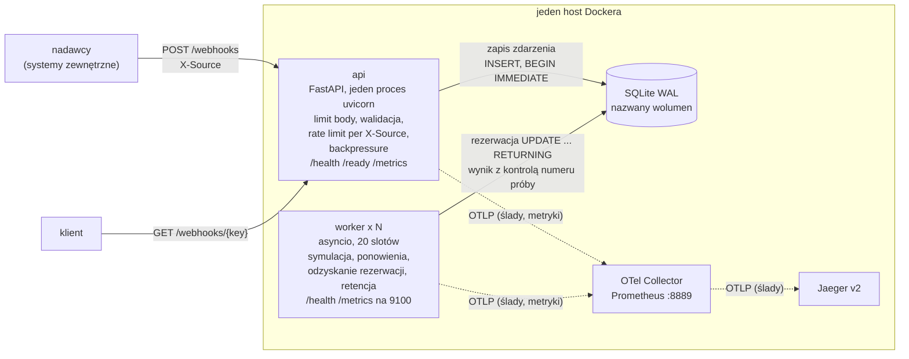
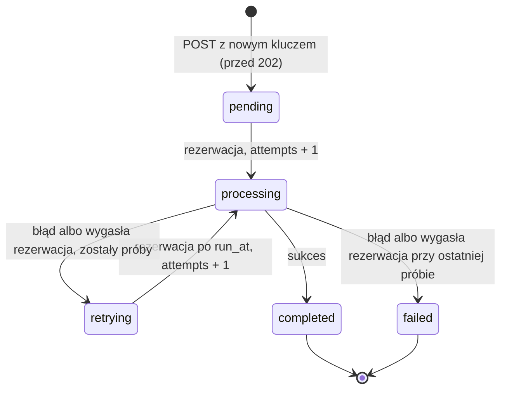

# Webhook Receiver

[](https://github.com/pksiazek/zadanie-webhook-receiver/actions/workflows/ci.yml)

Prototyp serwisu HTTP, który:

- przyjmuje webhooki JSON z `idempotency_key`,
- gwarantuje ich przetworzenie — także po restarcie lub awarii procesu,
- udostępnia status każdego zdarzenia.

Rozwiązanie [zadania rekrutacyjnego](https://gist.github.com/kaluzaaa/fcd035829013d9952f71a9a6a59a4d2f#file-gist_webhook_receiver-md).

**Stos:** Python 3.14, FastAPI, SQLite (WAL) jako magazyn **i** kolejka,
osobne procesy `api` i `worker`, OpenTelemetry (Collector, ślady w
Jaegerze, metryki Prometheus, logi JSON).

**Szczegóły:** [konfiguracja](docs/configuration.md) ·
[operacje](docs/operations.md) · [wyniki](docs/results.md) ·
[kompromisy](docs/tradeoffs.md)

## Spis treści

- [W skrócie](#w-skrócie)
- [Architektura](#architektura)
- [Co naprawdę gwarantujemy („dokładnie raz”)](#co-naprawdę-gwarantujemy-dokładnie-raz)
- [Uruchomienie](#uruchomienie)
- [Przykłady: webhooki z treści zadania](#przykłady-webhooki-z-treści-zadania)
- [API](#api)
- [Statusy zdarzenia](#statusy-zdarzenia)
- [Obserwowalność](#obserwowalność)
- [Wyniki](#wyniki)
- [Założenia skalowalności](#założenia-skalowalności)
- [Kompromisy (tradeoffy)](#kompromisy-tradeoffy)
- [TODO](#todo)
- [Struktura repozytorium i dokumenty](#struktura-repozytorium-i-dokumenty)

## W skrócie

| Pytanie | Odpowiedź |
|---|---|
| Jak uruchomić? | `docker compose up -d --build --wait` — API na `localhost:8000`, Jaeger na `localhost:16686` ([szczegóły](#uruchomienie)) |
| Czy zdarzenie po `202` może zginąć? | Nie. `202` wychodzi dopiero po trwałym zapisie (`COMMIT` z `synchronous=FULL`, czyli fsync). |
| Co, gdy worker padnie? | Jego rezerwacja wygasa i zdarzenie przejmuje inny worker. |
| Czy duplikat jest przetwarzany ponownie? | Nie. `UNIQUE(idempotency_key)`; duplikat dostaje `200` z aktualnym statusem. |
| Czy „dokładnie raz” jest prawdą? | Zapis zdarzenia i zapis wyniku — dokładnie raz. Samo wykonanie — co najmniej raz ([dlaczego](#co-naprawdę-gwarantujemy-dokładnie-raz)). |
| Skąd nagłówek `X-Source`? | Nie ma go w treści zadania. Wymagamy go, bo rate limit liczony jest per nadawca. Bez niego `400`. |
| Czy wytrzymuje 1000 webhooków/min? | Tak. p99 `POST`: 19,3 ms przy 1000/min i 17,0 ms przy 3000/min. Przetwarzanie skaluje się liniowo z liczbą workerów (99,8–99,9%) ([wyniki](#wyniki)). |
| Gdzie są kompromisy i braki? | [Kompromisy](#kompromisy-tradeoffy) i [TODO](#todo) |

## Architektura

Osobne procesy `api` i `worker` korzystają ze wspólnego kodu i **jednego
pliku SQLite, który jest jednocześnie magazynem i kolejką**.

Wiersz ze statusem `pending` *jest* zadaniem do wykonania. Powstaje w tej
samej transakcji co zapis zdarzenia, więc nie ma problemu podwójnego zapisu
(baza + broker).



- **api** zapisuje zdarzenie i odpowiada `202`. Niczego nie przetwarza,
  więc rosnąca kolejka nie wydłuża `POST`.
- **worker** (3 procesy × 20 slotów asyncio):
  - atomowo rezerwuje zdarzenia gotowe do wykonania,
  - symuluje przetwarzanie (2–5 s),
  - zapisuje wynik albo planuje ponowienie z wykładniczym odstępem,
  - dobiera pracę od razu po zwolnieniu slotu; gdy nie było nic do
    pobrania, sprawdza kolejkę co `POLL_INTERVAL_SECONDS` (0,5 s).
- **OTel Collector** zbiera ślady i metryki wszystkich procesów. Ślady
  przekazuje do Jaegera, metryki wystawia na jednym endpoincie Prometheus.
- **Ślad** przechodzi przez granicę procesów. API zapisuje W3C
  `traceparent` w wierszu zdarzenia, a worker tworzy z niego span
  `webhook.process` dla każdej próby.

## Co naprawdę gwarantujemy („dokładnie raz”)

„Dokładnie raz” rozkłada się na trzy etapy, a każdy ma inną gwarancję:

| Etap | Gwarancja | Jak |
|---|---|---|
| Zapis zdarzenia | **dokładnie raz** | `UNIQUE(idempotency_key)`. Zapis i decyzja „nowe czy duplikat” w jednej transakcji `BEGIN IMMEDIATE`. `202` dopiero po `COMMIT` z `synchronous=FULL`. |
| Wykonanie przetwarzania | **co najmniej raz** | Worker rezerwuje zdarzenie na `LEASE_SECONDS` (30 s). Jeśli padnie, rezerwacja wygasa, a inny worker ją odzyskuje i wykonuje kolejną próbę. |
| Zapis wyniku | **dokładnie raz** | Kontrola numeru próby — wynik spóźnionego workera jest odrzucany (niżej). |

**Kontrola numeru próby.** Każda rezerwacja zwiększa `attempts`. Wynik
zapisywany jest warunkowo:

```sql
UPDATE … WHERE id = ? AND status = 'processing' AND attempts = ?
```

Worker, którego rezerwacja wygasła, ma nieaktualny numer próby. Jego zapis
nie trafia w żaden wiersz i jest odrzucany — widać to w logu
(`stale_result`) i w metryce `webhook_stale_results_total`.

**Restart lub awaria API:**

- **Między `COMMIT` a wysłaniem `202`:** klient nie dostaje odpowiedzi i
  ponawia. Ponowienie trafia na istniejący klucz i dostaje `200` z
  aktualnym statusem. Zdarzenie nie ginie i nie jest przetwarzane dwa razy.
- **Przed `COMMIT`:** nic nie zostało zapisane. Ponowienie zapisuje
  zdarzenie jako nowe (`202`).

**Restart lub awaria workera:**

- **Awaria:** zdarzenia w `processing` czekają, aż wygaśnie rezerwacja (do
  30 s). Potem przejmuje je inny worker (`retrying`,
  `last_error = "lease expired"`).
- **Łagodne zamykanie (SIGTERM):** worker przestaje pobierać pracę i czeka
  na trwające próby do `SHUTDOWN_GRACE_SECONDS` (10 s).
- `stop_grace_period: 20s` w compose pilnuje, żeby Docker nie zabił
  workera wcześniej.

**Co to znaczy dla prawdziwego przetwarzania.** Tutaj przetwarzanie to
tylko symulacja (`sleep`). W prawdziwym systemie byłaby to akcja na
zewnątrz, np. wysłanie maila albo obciążenie karty.

Jeśli worker padnie **po** wykonaniu takiej akcji, ale **przed** zapisaniem
wyniku, inny worker wykona ją jeszcze raz. Dlatego ta akcja musi być
bezpieczna do powtórzenia. Najprościej: przekazywać `idempotency_key` do
zewnętrznego systemu, żeby rozpoznał powtórkę i ją pominął.

**Więcej:**

- szczegóły i granica ochrony przed duplikatami (retencja) →
  [docs/tradeoffs.md](docs/tradeoffs.md#gwarancje-założenia-i-restart-workera)
- demo awarii workera i restartu API →
  [docs/operations.md](docs/operations.md#awaria-workera-i-restart-api)

## Uruchomienie

**Docker** — dowolny host z Docker Engine i Compose v2 (obraz amd64/arm64):

```bash
docker compose up -d --build --wait           # api + 3 workery + Collector + Jaeger
docker compose ps                             # api i workery: (healthy)
docker compose up -d --wait --scale worker=5  # więcej workerów
docker compose down                           # dane zostają; down -v usuwa też dane
```

- API: `localhost:8000`
- Jaeger UI: `localhost:16686`
- metryki wszystkich procesów (Collector): `localhost:8889/metrics`
- porty i wymagania →
  [docs/configuration.md](docs/configuration.md#docker-wymagania-i-porty)
- pętla restartów przy błędzie konfiguracji →
  [docs/operations.md](docs/operations.md#pętla-restartów-przy-błędzie-konfiguracji)

### Testy

```bash
uv sync --extra dev                                   # zależności testowe
uv run ruff check . && uv run ruff format --check .   # jak w CI
uv run pytest            # unit + integration, próg pokrycia 85%
```

Test obciążeniowy i benchmarki →
[docs/operations.md](docs/operations.md#testy-test-obciążeniowy-benchmarki).

## Przykłady: webhooki z treści zadania

Pięć webhooków z treści zadania, przepisanych dosłownie.

> Nagłówek `X-Source` nie występuje w treści zadania. Wymagamy go, bo rate
> limit liczony jest per nadawca — bez niego `400`.

```bash
H='Content-Type: application/json'
curl -s -X POST localhost:8000/webhooks -H "$H" -H 'X-Source: shop' -d '{
  "idempotency_key": "evt-001",
  "event_type": "order.created",
  "payload": {"order_id": "ORD-2024-1234", "customer": "Jan Kowalski",
              "amount": 299.99, "currency": "PLN"}}'
curl -s -X POST localhost:8000/webhooks -H "$H" -H 'X-Source: shop' -d '{
  "idempotency_key": "evt-002",
  "event_type": "order.paid",
  "payload": {"order_id": "ORD-2024-1234", "payment_method": "card",
              "paid_at": "2024-12-01T14:30:00Z"}}'
curl -s -X POST localhost:8000/webhooks -H "$H" -H 'X-Source: shop' -d '{
  "idempotency_key": "evt-003",
  "event_type": "order.shipped",
  "payload": {"order_id": "ORD-2024-1234", "tracking_number": "PL1234567890",
              "carrier": "DPD"}}'
curl -s -X POST localhost:8000/webhooks -H "$H" -H 'X-Source: crm' -d '{
  "idempotency_key": "evt-004",
  "event_type": "user.registered",
  "payload": {"user_id": "USR-9876", "email": "jan@example.com"}}'
curl -s -X POST localhost:8000/webhooks -H "$H" -H 'X-Source: payments' -d '{
  "idempotency_key": "evt-005",
  "event_type": "payment.failed",
  "payload": {"order_id": "ORD-2024-5678", "reason": "insufficient_funds"}}'
```

Każde żądanie zwraca `202` z nagłówkiem `Location`:

```json
{"idempotency_key":"evt-001","status":"pending","status_url":"/webhooks/evt-001"}
```

Po 2–5 s `GET` pokazuje `"status":"completed"` i wynik.

**Duplikat** — ten sam klucz (treść nie jest porównywana):

- odpowiedź `200` z aktualnym statusem pierwotnego zdarzenia i
  `"duplicate": true`,
- nic nie jest zapisywane ani przetwarzane ponownie.

```bash
curl -s localhost:8000/webhooks/evt-001
curl -s -w ' HTTP %{http_code}\n' -X POST localhost:8000/webhooks -H "$H" \
  -H 'X-Source: shop' \
  -d '{"idempotency_key": "evt-001", "event_type": "order.created", "payload": {}}'
```

Ponowienia (`payload.simulate`: `fail_once`, `fail_always`) i rate limiting →
[docs/operations.md](docs/operations.md#ponowienia-i-rate-limiting).

## API

**`POST /webhooks`**

- nagłówek `X-Source` (1–64 znaki),
- body `{"idempotency_key", "event_type", "payload"}`,
- `idempotency_key`: niepusty string do 255 znaków, globalnie unikalny.

**`GET /webhooks/{idempotency_key}`** zwraca status zdarzenia.

- klucz kodowany procentowo, np. `evt%2F1`,
- nieznany klucz → `404`.

### Kody odpowiedzi `POST`

| Sytuacja | Kod | Uwagi |
|---|---|---|
| nowe zdarzenie, zapisane trwale | `202` | `{idempotency_key, status: "pending", status_url}` + nagłówek `Location` |
| duplikat (ten sam klucz, dowolna treść) | `200` | aktualny status jak w `GET` + `"duplicate": true` |
| body > 256 KiB | `413` | odrzucane przed jakąkolwiek inną pracą |
| brak lub zbyt długi `X-Source` | `400` | |
| niepoprawne body | `422` | lista błędów bez treści zgłoszenia |
| przekroczony limit nadawcy | `429` + `Retry-After` | duplikaty też zużywają limit |
| za duża zaległość (`pending`+`retrying` ≥ `MAX_BACKLOG`, domyślnie 100 000) | `503` + `Retry-After` | tylko nowe zdarzenia |
| chwilowa blokada SQLite (`SQLITE_BUSY` / `SQLITE_LOCKED` po `busy_timeout` 5 s) | `503` + `Retry-After` | także duplikat |
| inny błąd bazy (I/O, uszkodzony plik) | `500` | |

Uwagi do tabeli:

- `Location` zawiera klucz zakodowany procentowo.
- `413` **nie jest liczone** w `webhooks_received_total`.
- Przy za dużej zaległości duplikat nadal dostaje `200`: nie dodaje pracy,
  a nadawca ponawiający w pętli nie pogłębia zalewu.
- Przy blokadzie SQLite duplikat dostaje `503`, bo jego status nie jest
  wtedy znany. Odpowiedź nie zawiera treści błędu bazy.

### Kolejność kontroli

1. `413` — rozmiar body
2. `400` — `X-Source`
3. `422` — walidacja body
4. `429` — rate limit
5. `503` — backpressure (najpierw sprawdzenie, czy to duplikat)
6. zapis zdarzenia → `202` albo `200` (przy blokadzie SQLite `503`)

### Rate limiting

- token bucket per `X-Source`, w pamięci procesu API,
- 50 żądań/s, burst 100,
- kubełki w LRU do 10 000 źródeł (ogranicza pamięć limitera, nie liczbę
  serii metryk per `source` → [TODO](#todo)),
- limit działa w obrębie jednego procesu API.

Szczegóły, `Retry-After`, pola odpowiedzi `GET` i endpointy operacyjne →
[docs/operations.md](docs/operations.md#api--szczegóły).

## Statusy zdarzenia



Przejścia z dokładnymi warunkami →
[docs/operations.md](docs/operations.md#przejścia-statusów).

## Obserwowalność

- **Metryki API** (`/metrics`):
  - `webhooks_received_total{source,outcome}`,
  - `webhook_queue_depth{status}`,
  - `webhook_queue_oldest_pending_age_seconds` — sygnał „nikt nie
    przetwarza”.
- **Metryki workera:** `/metrics` na porcie 9100 (w sieci compose).
- **Wszystkie metryki naraz:** Collector na `localhost:8889/metrics`.
  Procesy rozróżnia etykieta `job` (`webhook-api`, `webhook-worker`) i
  `instance` (`<hostname>-<pid>`).
- **Ślady** w Jaegerze (`localhost:16686`): `POST /webhooks` i
  `webhook.process` dla każdej próby — w jednym śladzie.
- **Logi** JSON na stdout, z `trace_id`, `idempotency_key` i `source`
  (nigdy payload).

**Więcej:**

- tabele metryk, Collector, ślad z `traceparent`, logi, liczba workerów →
  [docs/operations.md](docs/operations.md#obserwowalność)
- zapytania `sqlite3` (lista `failed`, zaległe, kopia bazy) →
  [docs/operations.md](docs/operations.md#sqlite-dla-operatora)

### Ile workerów działa

Każdy worker raportuje `webhook_worker_up` = 1, więc liczba serii = liczba
workerów:

```bash
curl -s localhost:8889/metrics | grep -c '^webhook_worker_up'   # np. 3
docker compose ps worker                                       # kontenery (healthy)
```

- Seria zatrzymanego workera znika po ~30 s (`metric_expiration`).
- Nowy kontener (`--scale`, ponowne utworzenie) może przez te ~30 s
  zawyżać licznik o 1. Restart w miejscu (np. po awarii procesu) zachowuje
  ten sam `instance`, więc licznik się nie zmienia.
- Pod obciążeniem także `webhook_queue_depth{status="processing"}` ≈ N × 20.

## Wyniki

**Sprzęt:** Apple Silicon, 10 rdzeni, Linux VM OrbStack na macOS,
devcontainer z docker-in-docker, wolumen btrfs.

Pełne tabele, środowisko i interpretacja → [docs/results.md](docs/results.md).

### Test obciążeniowy

| Scenariusz | Ruch | p99 `POST` | Wynik |
|---|---|---|---|
| `steady` (3 workery) | 1000/min przez 3 min, 3000 żądań | 19,3 ms (max 50,1 ms) | 3000 × `202`, kolejka maks. 9, 3000/3000 `completed`; **PASS** |
| `burst` (3 workery) | 3000/min przez 2 min, potem 100/min, potem 0 | 17,0 ms w fazie 3000/min | kolejka do 3904, do zera w t = 381 s (limit 900 s), 6416/6416 `completed`; **PASS** |
| `scaling` N = 1 / 2 / 3 | zalana kolejka, pomiar przez 120 s | 17,2 / 18,4 / 21,0 ms | 342,3 / 683,0 / 1025,8 zdarzeń/min, liniowość 100 / 99,8 / 99,9%; **PASS** |

### Benchmarki SQLite

Źródło: [`docs/results/benchmarks.txt`](docs/results/benchmarks.txt).

- **`synchronous=FULL` kosztuje ok. 2 ms na zapis przy 100 tx/s**
  (mediana 1,998 ms; bez przerw 0,442 ms). `NORMAL`: 0,195 ms.
  Liczby `FULL` mogą być optymistyczne (fsync w maszynie wirtualnej na
  macOS).
- **Rezerwacja nie zależy od długości kolejki** (do 100 000). Samo
  zapytanie trwa ok. 0,05 ms, reszta to commit.
- **Pułap zapisu: ok. 2200–2300 tx/s łącznie**, niezależnie od liczby
  procesów (SQLite ma jednego pisarza naraz).
- **Blokada zapisu nie jest sprawiedliwa.** Przy nasyceniu część procesów
  czeka pełny `busy_timeout` i dostaje `SQLITE_BUSY`.
- **Test obciążeniowy zużywał ≤ ~50 tx/s, ok. 2% pułapu** (szacunek) —
  stąd liniowe skalowanie.
- **Porcja retencji (1000 wierszy) trzyma blokadę ok. 2 ms.**
  Także przy 100 000 już wyczyszczonych wierszy (indeks
  `ix_events_purgeable`; wcześniej koszt rósł z ich liczbą).

## Założenia skalowalności

- **Workery:** 1000/min ≈ 17/s. Przy średnio 3,5 s przetwarzania potrzeba
  ~60 slotów, czyli 3 workery × 20 (≈ 1030/min; zmierzone 1025,8/min).
  Więcej przez `--scale worker=N`; skalowanie liniowe do N = 3 (99,9%).
- **Zapis do SQLite:** jeden pisarz, pułap ok. 2200–2300 tx/s przy
  nasyceniu, wobec ≤ ~50 tx/s (szacunek) przy docelowym ruchu. Przy
  wielokrotnie większym ruchu wąskim gardłem stanie się blokada zapisu.
- **Przyjmowanie:** jeden proces API, p99 `POST` ≤ 21 ms do 3000/min.
- **Granica: jeden host.** Dalej: PostgreSQL
  (`SELECT … FOR UPDATE SKIP LOCKED`) albo broker z outboxem, współdzielony
  rate limiter (→ [TODO](#todo)).

## Kompromisy (tradeoffy)

Każdy punkt ma rozwinięcie w [docs/tradeoffs.md](docs/tradeoffs.md).

- **Readiness API niezależne od workera.**
  `/ready` sprawdza bazę i schemat, więc jest zielone przy martwych
  workerach — przyjmowanie nie zależy od przetwarzania. Problem widać w
  `docker compose ps` i po rosnącym
  `webhook_queue_oldest_pending_age_seconds`. Przy pustej kolejce
  bezczynny worker jest nieodróżnialny od martwego.
  [Więcej](docs/tradeoffs.md#readiness-api-niezależne-od-workera)
- **`synchronous=FULL`, nie `NORMAL`.**
  `202` obiecuje trwałość, a `NORMAL` może zgubić ostatnie commity przy
  zaniku zasilania. Koszt: ok. 2 ms na zapis.
  [Więcej](docs/tradeoffs.md#synchronousfull-zamiast-normal)
- **Schemat.**
  Jedna tabela `STRICT`; `id` (alias `rowid`) obok `UNIQUE` klucza; czasy
  jako INTEGER ms; `run_at` zamiast dwóch terminów; indeksy częściowe pod
  zapytania; kontrola numeru próby.
  [Więcej](docs/tradeoffs.md#schemat)
- **SQLite współdzielony przez kontenery.**
  Działa dzięki wspólnemu jądru (blokady `fcntl`, `-shm` przez `mmap`).
  Warunki: jeden host, bez NFS, nazwany wolumen, ten sam UID, jeden pisarz
  naraz.
  [Więcej](docs/tradeoffs.md#sqlite-współdzielony-przez-kilka-kontenerów)
- **Co najmniej raz z efektem dokładnie raz.**
  Po awarii workera symulacja może się powtórzyć, a zdarzenie czeka do
  30 s na odzyskanie rezerwacji.
  [Więcej](docs/tradeoffs.md#semantyka-co-najmniej-raz-z-efektem-dokładnie-raz)
- **Retencja w dwóch progach (GDPR).**
  Payload `completed` czyszczony po 7 dniach, wiersze usuwane po 30.
  Okno retencji klucza = okno ochrony przed duplikatami. Plik bazy nie
  maleje.
  [Więcej](docs/tradeoffs.md#retencja-dwa-progi-gdpr-plik-nie-maleje)
- **Payload zdarzeń `failed` zostaje 30 dni.**
  Może zawierać dane osobowe, ale jest potrzebny do diagnozy — dłużej niż
  7 dni dla `completed`. Skraca to `RETENTION_FAILED_DAYS`.
  [Więcej](docs/tradeoffs.md#retencja-dwa-progi-gdpr-plik-nie-maleje)
- **Jeden proces uvicorn.**
  Rate limiter i cache statystyk kolejki są w pamięci procesu.
  [Więcej](docs/tradeoffs.md#jeden-proces-uvicorn)
- **Duplikat bez porównania treści** (dosłownie według zadania).
  Inny webhook z tym samym kluczem przepada bez sygnału.
  [Więcej](docs/tradeoffs.md#duplikat-bez-porównania-treści)
- **Klucze `.` i `..`.**
  Są przyjmowane, ale `GET` przez ścieżkę ich nie odpyta (normalizacja
  segmentów).
  [Więcej](docs/tradeoffs.md#klucze--i-)

## TODO

- **Format `idempotency_key`:** doprecyzować z nadawcami (zestaw znaków,
  długość, struktura) i wybrać rozwiązanie:
  - obecne (dowolny string + kodowanie procentowe),
  - ograniczony zestaw znaków,
  - klucz poza ścieżką (parametr zapytania / wewnętrzny identyfikator).

  To rozwiązuje też problem kluczy `.` i `..`.
- **Uwierzytelnianie nadawców:** podpisy HMAC zamiast zaufania do
  `X-Source`; ograniczenie kardynalności `source` w metrykach (dziś każda
  wartość nagłówka to nowa seria).
- **Poziome skalowanie API:** współdzielony rate limit (np. Redis) i cache
  statystyk — wiele procesów uvicorn / instancji.
- **Wyjście poza jeden host i jednego pisarza SQLite:** PostgreSQL
  (`SELECT … FOR UPDATE SKIP LOCKED`) albo broker z outboxem.
- **Pełny stos obserwowalności:** Prometheus, Grafana i Tempo z
  dashboardami (dziś Collector wystawia tylko endpoint `:8889`, bez
  przechowywania historii).
- **Alerty** (`webhook_queue_oldest_pending_age_seconds`, przyrost
  `failed`, `db_busy`) i dead-letter dla `failed`.
- **Endpointy operatora:** ręczne ponowienie `failed`, lista `failed` i
  zaległych (zamiast zapytań `sqlite3`).
- **Niezgodność treści przy ponowieniu z tym samym kluczem:** hash
  payloadu + `409` albo metryka.
- **Osobny próg czyszczenia payloadu** (albo maskowanie) dla zdarzeń
  `failed`.
- **`PRAGMA auto_vacuum=INCREMENTAL`** + okresowe `incremental_vacuum`.
- **Migracje schematu** (dziś `CREATE … IF NOT EXISTS` przy starcie).
- **`OTEL_SERVICE_NAME`:** uwzględniać zmienną (dziś nazwa usługi jest w
  kodzie).
- **Metryki:** liczyć odrzucenia `413`; osobna metryka awarii wbudowanego
  workera (`EMBEDDED_WORKER`; dziś tylko log).
- **Pomiary:** użyteczny pułap zapisu przy p99 < 100 ms; pomiary na
  serwerze z Linuksem, bez warstwy wirtualizacji macOS.

## Struktura repozytorium i dokumenty

```
src/webhook_receiver/
  __main__.py   python -m webhook_receiver api|worker (tryb EMBEDDED_WORKER)
  common/       config, clock, models, db (schemat, pragmy), repository (SQL), telemetry, logging
  api/          app.py (create_app), schemas, body_limit, ratelimit, queue_stats
  worker/       app.py (create_worker), http (/health, /metrics), backoff, simulation
tests/          unit/, integration/, loadtest/
loadtest/       generator obciążenia (steady, burst, flood, scaling-report), scaling.sh
benchmarks/     benchmarki SQLite (sync, claim, contention, retention)
docs/           configuration.md, operations.md, results.md, tradeoffs.md, results/, superpowers/specs/, superpowers/plans/
```

- `otel-collector.yaml` — konfiguracja Collectora.
- `api` i `worker` importują tylko z `common` (pilnuje tego test
  architektury).
- Jeden obraz Dockera, dwie komendy, użytkownik inny niż root.
- Pełne uzasadnienia decyzji:
  [dokument projektowy](docs/superpowers/specs/2026-10-25-webhook-receiver-design.md)
  i [zapis brainstormingu](docs/superpowers/specs/2026-10-25-webhook-receiver-brainstorming.md).
