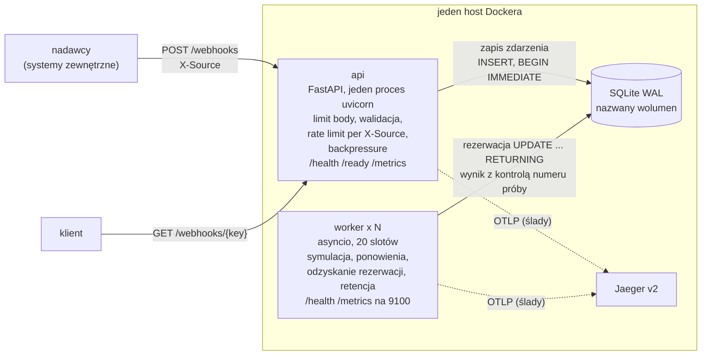
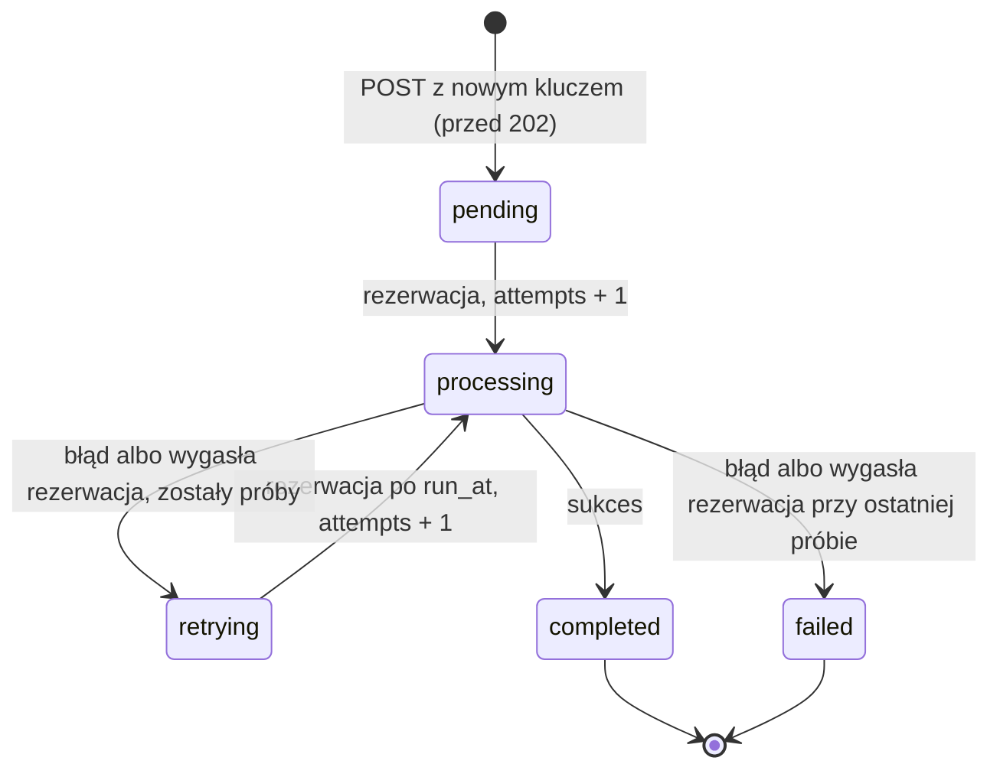

# Webhook Receiver

[](https://github.com/pksiazek/zadanie-webhook-receiver/actions/workflows/ci.yml)

Prototyp serwisu HTTP, który przyjmuje webhooki JSON z `idempotency_key`,
gwarantuje ich przetworzenie (także po restarcie lub awarii procesu) i
udostępnia status każdego zdarzenia. Rozwiązanie
[zadania rekrutacyjnego](https://gist.github.com/kaluzaaa/fcd035829013d9952f71a9a6a59a4d2f#file-gist_webhook_receiver-md).

Python 3.14, FastAPI, SQLite (WAL) jako magazyn **i** kolejka, osobne
procesy `api` i `worker`, OpenTelemetry (ślady do Jaegera, metryki
Prometheus, logi JSON). Szczegóły: [konfiguracja](docs/configuration.md),
[operacje](docs/operations.md), [wyniki](docs/results.md), [kompromisy](docs/tradeoffs.md).

## Spis treści

- [Wymagania z zadania → gdzie](#wymagania-z-zadania--gdzie)
- [W skrócie](#w-skrócie)
- [Architektura](#architektura)
- [Co naprawdę gwarantujemy („dokładnie raz”)](#co-naprawdę-gwarantujemy-dokładnie-raz)
- [Uruchomienie](#uruchomienie)
- [Przykłady: webhooki z treści zadania](#przykłady-webhooki-z-treści-zadania)
- [API](#api)
- [Statusy zdarzenia](#statusy-zdarzenia)
- [Obserwowalność](#obserwowalność)
- [Wyniki](#wyniki)
- [Założenia skalowalności](#założenia-skalowalności)
- [Kompromisy (tradeoffy)](#kompromisy-tradeoffy)
- [TODO](#todo)
- [Struktura repozytorium i dokumenty](#struktura-repozytorium-i-dokumenty)

## Wymagania z zadania → gdzie

| Z treści zadania | Gdzie |
|---|---|
| **HTTP API**, które przyjmuje webhooki i udostępnia status | [API](#api), [przykłady](#przykłady-webhooki-z-treści-zadania) |
| **SQLite** jako baza danych | [architektura](#architektura), [schemat](docs/tradeoffs.md#schemat) |
| Przetwarzanie async (`sleep(2-5s)` + zapis wyniku) | [architektura](#architektura), [statusy](#statusy-zdarzenia) |
| Przetworzenie **dokładnie raz**, także po restarcie | [gwarancje](#co-naprawdę-gwarantujemy-dokładnie-raz), [demonstracje](docs/operations.md#demonstracje) |
| Sprawdzenie statusu przetwarzania | [`GET /webhooks/{key}`](docs/operations.md#get-webhooksidempotency_key) |
| Poprawne działanie przy wielu równoczesnych webhookach | [założenia skalowalności](#założenia-skalowalności), [wyniki](#wyniki) |
| Zdefiniowana retencja | [retencja](docs/tradeoffs.md#retencja-dwa-progi-gdpr-plik-nie-maleje) |
| README: architektura, tradeoffs, instrukcje uruchomienia | [architektura](#architektura), [kompromisy](#kompromisy-tradeoffy), [uruchomienie](#uruchomienie) |
| Działający kod w Pythonie, który można uruchomić i przetestować | [uruchomienie](#uruchomienie), [testy](#testy) |
| Dockerfile | [`Dockerfile`](Dockerfile), [`docker-compose.yml`](docker-compose.yml), [uruchomienie](#uruchomienie) |
| Sekcja `# TODO` | [TODO](#todo) |
| Bonus: testy jednostkowe | [testy](docs/operations.md#testy-test-obciążeniowy-benchmarki) (próg pokrycia 85% w CI) |
| Bonus: rate limiting | [API](#api), [szczegóły](docs/operations.md#post-webhooks) |
| Bonus: metryki, health/readiness | [obserwowalność](docs/operations.md#obserwowalność), [endpointy](docs/operations.md#endpointy-operacyjne) |
| Bonus: retry dla failed webhooków | [statusy](#statusy-zdarzenia), [demo ponowień](docs/operations.md#ponowienia-i-rate-limiting) |
| Bonus: testy obciążeniowe lub benchmarki | oba: [wyniki](docs/results.md) |
| Ocena: niezawodność (restart) | [gwarancje](#co-naprawdę-gwarantujemy-dokładnie-raz) |
| Ocena: idempotency (duplikaty) | [gwarancje](#co-naprawdę-gwarantujemy-dokładnie-raz), [duplikat](#przykłady-webhooki-z-treści-zadania) |
| Ocena: przetwarzanie async | [architektura](#architektura), [wynik `burst`](docs/results.md#burst--3000min-potem-100min-potem-cisza-resultsbursttxt) |
| Ocena: model danych (indeksy, statusy) | [schemat](docs/tradeoffs.md#schemat), [statusy](#statusy-zdarzenia) |
| Ocena: obserwowalność | [obserwowalność](#obserwowalność), [szczegóły](docs/operations.md#obserwowalność) |
| Ocena: tradeoffs | [kompromisy](#kompromisy-tradeoffy), [szczegóły](docs/tradeoffs.md) |

## W skrócie

| Pytanie | Odpowiedź |
|---|---|
| Jak uruchomić? | `docker compose up -d --build --wait` → API na `localhost:8000`, Jaeger na `localhost:16686` ([szczegóły](#uruchomienie)) |
| Czy zdarzenie po `202` może zginąć? | Nie: `202` dopiero po `COMMIT` z `synchronous=FULL` (fsync); worker, który padnie, traci rezerwację i zdarzenie podejmuje inny |
| Czy duplikat jest przetwarzany ponownie? | Nie: `UNIQUE(idempotency_key)`, duplikat dostaje `200` z aktualnym statusem |
| Czy „dokładnie raz” jest prawdą? | Zapis zdarzenia i zapis wyniku — dokładnie raz; samo wykonanie — co najmniej raz ([dlaczego](#co-naprawdę-gwarantujemy-dokładnie-raz)) |
| Skąd nagłówek `X-Source`? | Nie ma go w treści zadania — wymagamy go, bo rate limit liczony jest per nadawca; bez niego `400` |
| Czy wytrzymuje 1000 webhooków/min? | Tak: p99 `POST` 19,3 ms przy 1000/min, 17,0 ms przy 3000/min; przetwarzanie skaluje się liniowo z liczbą workerów (99,8–99,9%) ([wyniki](#wyniki)) |
| Gdzie są kompromisy i braki? | [Kompromisy](#kompromisy-tradeoffy) i [TODO](#todo) |

## Architektura

**Osobne procesy `api` i `worker`, wspólny kod i jeden plik SQLite, który
jest jednocześnie magazynem i kolejką.** Wiersz ze statusem `pending` *jest*
zadaniem — zapisanym w tej samej transakcji co zdarzenie, więc nie ma
problemu podwójnego zapisu (baza + broker).



- **api** zapisuje zdarzenie i odpowiada `202`, nie przetwarza — rosnąca
  kolejka nie wydłuża `POST`. **worker** (3 × 20 slotów asyncio) atomowo
  rezerwuje należne zdarzenia, symuluje przetwarzanie (2–5 s), zapisuje
  wynik albo planuje ponowienie z wykładniczym odstępem. Pracę dobiera od
  razu po zwolnieniu slotu; gdy nie było nic do pobrania, sprawdza kolejkę
  co `POLL_INTERVAL_SECONDS` (0,5 s).
- **Ślad** przechodzi przez granicę procesów: API zapisuje W3C `traceparent`
  w wierszu, worker tworzy z niego span `webhook.process` na każdą próbę.
- Odrzucone: jeden proces z pulą asyncio (API i przetwarzanie dzielą los, brak
  niezależnego skalowania) i
  broker Redis/Celery (zadanie narzuca SQLite, podwójny zapis wymaga
  outboxa) — [dokument projektowy §5](docs/superpowers/specs/2026-10-25-webhook-receiver-design.md#5-wybrane-podejście).

## Co naprawdę gwarantujemy („dokładnie raz”)

Dokładnie-raz end-to-end nie jest możliwe bez współpracy samego efektu
ubocznego. Serwis gwarantuje:

| Co | Gwarancja | Mechanizm |
|---|---|---|
| Zapis zdarzenia | **dokładnie raz** | `UNIQUE(idempotency_key)`; `INSERT … ON CONFLICT DO NOTHING RETURNING` — zapis i decyzja „nowe/duplikat” w jednej transakcji `BEGIN IMMEDIATE`; `202` dopiero po `COMMIT` z `synchronous=FULL` |
| Wykonanie przetwarzania | **co najmniej raz** | worker rezerwuje zdarzenie na `LEASE_SECONDS` (30 s); jeśli padnie, rezerwacja wygasa, inny worker ją odzyskuje (`retrying`, `last_error = "lease expired"`) i wykonuje kolejną próbę |
| Efekt (zapis wyniku) | **dokładnie raz** | zapis warunkowy: `UPDATE … WHERE id = ? AND status = 'processing' AND attempts = ?`; każda rezerwacja zwiększa `attempts`, więc spóźniony worker z wygasłą rezerwacją ma nieaktualny numer próby — jego zapis nie trafia w żaden wiersz i jest odrzucany (log `stale_result`, metryka `webhook_stale_results_total`) |

**Restart lub awaria API:**

- **między `COMMIT` a wysłaniem `202`** — klient nie dostaje odpowiedzi i
  ponawia; ponowienie trafia na istniejący klucz i dostaje `200` z aktualnym
  statusem. Zdarzenie nie ginie i nie jest przetwarzane dwa razy;
- **przed `COMMIT`** — nic nie zostało zapisane, ponowienie zapisuje
  zdarzenie jako nowe (`202`).

**Założenie:** prawdziwy efekt uboczny (zamiast symulacji) musiałby być
idempotentny względem `idempotency_key` — wykonanie może się powtórzyć, gdy
worker padnie po wykonaniu, a przed zapisem wyniku.

**Restart lub awaria workera:** zdarzenia w `processing` czekają na
wygaśnięcie rezerwacji (do 30 s), potem są odzyskiwane. Łagodne zamykanie
(SIGTERM) przestaje pobierać pracę i czeka na trwające próby do
`SHUTDOWN_GRACE_SECONDS` (10 s); `stop_grace_period: 20s` w compose
pilnuje, żeby Docker nie zabił workera wcześniej.

Szczegóły i granica ochrony przed duplikatami (retencja) →
[docs/tradeoffs.md](docs/tradeoffs.md#gwarancje-założenia-i-restart-workera);
demo awarii workera i restartu API → [docs/operations.md](docs/operations.md#awaria-workera-i-restart-api).

## Uruchomienie

**Docker** (dowolny host z Docker Engine i Compose v2; obraz amd64/arm64):

```bash
docker compose up -d --build --wait           # api + 3 workery + Jaeger
docker compose ps                             # api i workery: (healthy)
docker compose up -d --wait --scale worker=5  # więcej workerów
docker compose down                           # dane zostają; down -v usuwa też dane
```

API: `localhost:8000`, Jaeger UI: `localhost:16686`. Porty →
[docs/configuration.md](docs/configuration.md#docker-wymagania-i-porty); pętla restartów przy błędzie
konfiguracji → [docs/operations.md](docs/operations.md#pętla-restartów-przy-błędzie-konfiguracji).

**Lokalnie (uv)**, worker w procesie API (tylko development; szczegóły →
[docs/configuration.md](docs/configuration.md#tryb-lokalny-uv)):

```bash
uv sync --extra dev
EMBEDDED_WORKER=true uv run python -m webhook_receiver api
```

**Devcontainer** z docker-in-docker (w nim powstały wszystkie wyniki),
polecenia jak na „gołym” hoście → [docs/configuration.md](docs/configuration.md#devcontainer).

### Testy

```bash
uv run ruff check . && uv run ruff format --check .   # jak w CI
uv run pytest            # unit + integration, próg pokrycia 85%
```

Test obciążeniowy i benchmarki → [docs/operations.md](docs/operations.md#testy-test-obciążeniowy-benchmarki).

## Przykłady: webhooki z treści zadania

Pięć przykładowych webhooków z treści zadania, dosłownie. Nagłówek
`X-Source` nie występuje w treści zadania — wymagamy go, bo rate limit
liczony jest per nadawca; bez niego `400`.

```bash
H='Content-Type: application/json'
curl -s -X POST localhost:8000/webhooks -H "$H" -H 'X-Source: shop' -d '{
  "idempotency_key": "evt-001",
  "event_type": "order.created",
  "payload": {"order_id": "ORD-2024-1234", "customer": "Jan Kowalski",
              "amount": 299.99, "currency": "PLN"}}'
curl -s -X POST localhost:8000/webhooks -H "$H" -H 'X-Source: shop' -d '{
  "idempotency_key": "evt-002",
  "event_type": "order.paid",
  "payload": {"order_id": "ORD-2024-1234", "payment_method": "card",
              "paid_at": "2024-12-01T14:30:00Z"}}'
curl -s -X POST localhost:8000/webhooks -H "$H" -H 'X-Source: shop' -d '{
  "idempotency_key": "evt-003",
  "event_type": "order.shipped",
  "payload": {"order_id": "ORD-2024-1234", "tracking_number": "PL1234567890",
              "carrier": "DPD"}}'
curl -s -X POST localhost:8000/webhooks -H "$H" -H 'X-Source: crm' -d '{
  "idempotency_key": "evt-004",
  "event_type": "user.registered",
  "payload": {"user_id": "USR-9876", "email": "jan@example.com"}}'
curl -s -X POST localhost:8000/webhooks -H "$H" -H 'X-Source: payments' -d '{
  "idempotency_key": "evt-005",
  "event_type": "payment.failed",
  "payload": {"order_id": "ORD-2024-5678", "reason": "insufficient_funds"}}'
```

Każde zwraca `202` z nagłówkiem `Location`
(`{"idempotency_key":"evt-001","status":"pending","status_url":"/webhooks/evt-001"}`);
po 2–5 s `GET` pokazuje `"status":"completed"` z wynikiem. **Duplikat** — ten
sam klucz (treść nie jest porównywana): `200`, aktualny status pierwotnego
zdarzenia i `"duplicate": true`; nic nie jest zapisywane ani przetwarzane
ponownie.

```bash
curl -s localhost:8000/webhooks/evt-001
curl -s -w ' HTTP %{http_code}\n' -X POST localhost:8000/webhooks -H "$H" \
  -H 'X-Source: shop' \
  -d '{"idempotency_key": "evt-001", "event_type": "order.created", "payload": {}}'
```

Ponowienia (`payload.simulate`: `fail_once`, `fail_always`) i rate limiting →
[docs/operations.md](docs/operations.md#ponowienia-i-rate-limiting).

## API

`POST /webhooks` z nagłówkiem `X-Source` (1–64 znaki) i body
`{"idempotency_key", "event_type", "payload"}`; klucz: niepusty string do
255 znaków, globalnie unikalny. `GET /webhooks/{idempotency_key}` (klucz
kodowany procentowo, np. `evt%2F1`) zwraca status; nieznany klucz → `404`.

| Sytuacja | Kod | Uwagi |
|---|---|---|
| nowe zdarzenie, zapisane trwale | `202` | `{idempotency_key, status: "pending", status_url}` + nagłówek `Location` (klucz zakodowany procentowo) |
| duplikat (ten sam klucz, dowolna treść) | `200` | aktualny status jak w `GET` + `"duplicate": true`; także przy przekroczonym progu zaległości |
| body > 256 KiB | `413` | odrzucane przez middleware przed jakąkolwiek inną pracą; **nie jest liczone** w `webhooks_received_total` |
| brak lub zbyt długi `X-Source` | `400` | |
| niepoprawne body | `422` | lista błędów bez treści zgłoszenia |
| przekroczony limit nadawcy | `429` + `Retry-After` | duplikaty też zużywają limit |
| przekroczony próg zaległości (`pending`+`retrying` ≥ `MAX_BACKLOG`, domyślnie 100 000) | `503` + `Retry-After` | tylko nowe zdarzenia; duplikat dostaje `200` — nie dodaje pracy, a nadawca w pętli ponowień nie pogłębia zalewu |
| chwilowa rywalizacja o zapis w SQLite (`SQLITE_BUSY`/`SQLITE_LOCKED` po `busy_timeout` 5 s) | `503` + `Retry-After` | także duplikat — jego status nie jest wtedy znany; bez treści błędu bazy |
| inny błąd bazy (I/O, uszkodzony plik) | `500` | |

**Kolejność kontroli:** `413` (rozmiar) → `400` (`X-Source`) → `422`
(walidacja body) → `429` (rate limit) → `503` (backpressure; najpierw
sprawdzenie, czy to duplikat) → zapis zdarzenia (`202` / `200`; przy
rywalizacji o blokadę `503`).

**Rate limiting:** token bucket per `X-Source` w pamięci procesu API (50
żądań/s, burst 100), kubełki w LRU do 10 000 źródeł; limit działa w obrębie
jednego procesu API. Szczegóły, `Retry-After`, pola odpowiedzi `GET` i
endpointy operacyjne → [docs/operations.md](docs/operations.md#api--szczegóły).

## Statusy zdarzenia



Przejścia z dokładnymi warunkami → [docs/operations.md](docs/operations.md#przejścia-statusów).

## Obserwowalność

- **Metryki** na `/metrics` API: `webhooks_received_total{source,outcome}`,
  `webhook_queue_depth{status}`, `webhook_queue_oldest_pending_age_seconds`
  (sygnał „nikt nie przetwarza”); metryki przetwarzania na `/metrics`
  workera (port 9100 w sieci compose).
- **Ślady** w Jaegerze (`localhost:16686`): `POST /webhooks` i
  `webhook.process` na każdą próbę w jednym śladzie. **Logi** JSON na
  stdout z `trace_id`, `idempotency_key`, `source` (nigdy payload).
- **Ile workerów działa:** `docker compose ps worker` (kontenery
  `(healthy)`); pod obciążeniem `webhook_queue_depth{status="processing"}`
  ≈ N × 20.

Tabele metryk, ślad z `traceparent`, logi, liczba workerów →
[docs/operations.md](docs/operations.md#obserwowalność); zapytania `sqlite3` (lista `failed`,
zaległe, kopia bazy) → [docs/operations.md](docs/operations.md#sqlite-dla-operatora).

## Wyniki

Sprzęt: Apple Silicon, 10 rdzeni, Linux VM OrbStack na macOS, devcontainer z docker-in-docker, wolumen btrfs.
Pełne tabele, środowisko i interpretacja → [docs/results.md](docs/results.md).

| Scenariusz | Ruch | p99 `POST` | Wynik |
|---|---|---|---|
| `steady` (3 workery) | 1000/min przez 3 min, 3000 żądań | 19,3 ms (max 50,1 ms) | 3000 × `202`, kolejka maks. 9, 3000/3000 `completed`; **PASS** |
| `burst` (3 workery) | 3000/min przez 2 min, potem 100/min, potem 0 | 17,0 ms w fazie 3000/min | kolejka do 3904, do zera w t = 381 s (limit 900 s), 6416/6416 `completed`; **PASS** |
| `scaling` N = 1 / 2 / 3 | zalana kolejka, pomiar przez 120 s | 17,2 / 18,4 / 21,0 ms | 342,3 / 683,0 / 1025,8 zdarzeń/min, liniowość 100 / 99,8 / 99,9%; **PASS** |

Benchmarki SQLite ([`results/benchmarks.txt`](results/benchmarks.txt)):
- **`synchronous=FULL` ≈ 2 ms na zapis przy 100 tx/s** (mediana 2,059 ms;
  0,419 ms bez przerw), `NORMAL` 0,206 ms; liczby `FULL` mogą być
  optymistyczne (fsync w maszynie wirtualnej na macOS).
- **Rezerwacja nie zależy od długości kolejki** do 100 000: samo zapytanie
  ok. 0,05 ms, reszta to commit.
- **Pułap zapisu ok. 2200–2300 tx/s łącznie niezależnie od liczby procesów**
  (jeden pisarz); blokada nie jest sprawiedliwa — przy nasyceniu część
  procesów czeka pełny `busy_timeout` i dostaje `SQLITE_BUSY`. Test
  obciążeniowy to ≤ ~50 tx/s, ok. 2% pułapu (szacunek) — stąd liniowość.
- **Porcja retencji 1000 wierszy trzyma blokadę ok. 2 ms.**

## Założenia skalowalności

- **1000/min ≈ 17/s**; przy średnio 3,5 s przetwarzania potrzeba ~60 slotów
  → 3 workery × 20 (≈ 1030/min, zmierzone 1025,8/min); więcej przez
  `--scale worker=N`, skalowanie liniowe do N = 3 (99,9%).
- **Zapis do SQLite:** jeden pisarz, pułap ok. 2200–2300 tx/s przy
  nasyceniu wobec ≤ ~50 tx/s (szacunek) przy docelowym ruchu; przy
  wielokrotnie większym ruchu wąskim gardłem stanie się blokada zapisu.
- **Przyjmowanie:** jeden proces API, p99 `POST` ≤ 21 ms do 3000/min.
- **Granica: jeden host.** Dalej: PostgreSQL (`SELECT … FOR UPDATE SKIP
  LOCKED`) albo broker z outboxem, współdzielony rate limiter (→ [TODO](#todo)).

## Kompromisy (tradeoffy)

- **Readiness API niezależne od workera:** `/ready` sprawdza bazę i schemat,
  więc jest zielone przy martwych workerach (przyjmowanie nie zależy od
  przetwarzania). Problem widać w `docker compose ps` i po rosnącym
  `webhook_queue_oldest_pending_age_seconds`; przy pustej kolejce bezczynny
  worker jest nieodróżnialny od martwego. [Więcej](docs/tradeoffs.md#readiness-api-niezależne-od-workera)
- **`synchronous=FULL`, nie `NORMAL`:** `202` obiecuje trwałość, a `NORMAL`
  może zgubić ostatnie commity przy zaniku zasilania; koszt ok. 2 ms na
  zapis. [Więcej](docs/tradeoffs.md#synchronousfull-zamiast-normal)
- **Schemat:** jedna tabela `STRICT`, `id` (alias `rowid`) obok `UNIQUE`
  klucza, czasy INTEGER ms, `run_at` zamiast dwóch terminów, indeksy
  częściowe pod zapytania, kontrola numeru próby. [Więcej](docs/tradeoffs.md#schemat)
- **SQLite współdzielony przez kontenery:** działa dzięki wspólnemu jądru
  (blokady `fcntl`, `-shm` przez `mmap`); tylko jeden host, bez NFS, nazwany
  wolumen, ten sam UID, jeden pisarz naraz. [Więcej](docs/tradeoffs.md#sqlite-współdzielony-przez-kilka-kontenerów)
- **Co najmniej raz z efektem dokładnie raz:** po awarii workera symulacja
  może się powtórzyć, a zdarzenie czeka do 30 s na odzyskanie rezerwacji.
  [Więcej](docs/tradeoffs.md#semantyka-co-najmniej-raz-z-efektem-dokładnie-raz)
- **Retencja w dwóch progach (GDPR):** payload `completed` czyszczony po 7
  dniach, wiersze usuwane po 30; okno retencji klucza = okno ochrony przed
  duplikatami; plik bazy nie maleje. [Więcej](docs/tradeoffs.md#retencja-dwa-progi-gdpr-plik-nie-maleje)
- **Payload zdarzeń `failed` (możliwe dane osobowe) zostaje 30 dni** do
  diagnozy — dłużej niż 7 dni dla `completed`; skraca to
  `RETENTION_FAILED_DAYS`. [Więcej](docs/tradeoffs.md#retencja-dwa-progi-gdpr-plik-nie-maleje)
- **Jeden proces uvicorn:** rate limiter i cache statystyk kolejki są w
  pamięci procesu. [Więcej](docs/tradeoffs.md#jeden-proces-uvicorn)
- **Duplikat bez porównania treści** (dosłownie według zadania): inny
  webhook z tym samym kluczem przepada bez sygnału. [Więcej](docs/tradeoffs.md#duplikat-bez-porównania-treści)
- **Klucze `.` i `..`** są przyjmowane, ale `GET` przez ścieżkę ich nie
  odpyta (normalizacja segmentów). [Więcej](docs/tradeoffs.md#klucze--i-)

## TODO

- **Doprecyzować z nadawcami format `idempotency_key`** (zestaw znaków,
  długość, struktura) i wybrać rozwiązanie: obecne (dowolny string +
  kodowanie procentowe), ograniczony zestaw znaków albo klucz poza ścieżką
  (parametr zapytania / wewnętrzny identyfikator); rozwiązuje też `.`/`..`.
- Uwierzytelnianie nadawców: podpisy HMAC (zamiast zaufania do `X-Source`).
- Współdzielony rate limit (np. Redis) i cache statystyk — poziome
  skalowanie API (wiele procesów uvicorn / instancji).
- PostgreSQL (`SELECT … FOR UPDATE SKIP LOCKED`) albo broker z outboxem —
  wyjście poza jeden host i jednego pisarza SQLite.
- OpenTelemetry Collector w compose (zbiorczy endpoint Prometheus, metryka
  `webhook_worker_up` per `service.instance.id` = liczba workerów) i pełny
  stos Prometheus/Grafana/Tempo z dashboardami.
- Alerty (`webhook_queue_oldest_pending_age_seconds`, przyrost `failed`,
  `db_busy`) i dead-letter dla `failed`.
- Endpointy operatora: ręczne ponowienie `failed`, lista `failed` i
  zaległych (zamiast zapytań `sqlite3`).
- Wykrywanie niezgodności treści przy ponowieniu z tym samym kluczem (hash
  payloadu + `409` albo metryka).
- Osobny próg czyszczenia payloadu (albo maskowanie) dla zdarzeń `failed`.
- `PRAGMA auto_vacuum=INCREMENTAL` + okresowe `incremental_vacuum`.
- Narzędzie migracji schematu (dziś `CREATE … IF NOT EXISTS` przy starcie).
- Uwzględniać `OTEL_SERVICE_NAME` (dziś nazwa usługi jest w kodzie).
- Liczyć odrzucenia `413` w metrykach; osobna metryka awarii wbudowanego
  workera (`EMBEDDED_WORKER`; dziś tylko log).
- Pomiar użytecznego pułapu zapisu przy p99 < 100 ms i pomiary na serwerze
  z Linuksem bez warstwy wirtualizacji macOS.

## Struktura repozytorium i dokumenty

```
src/webhook_receiver/
  __main__.py   python -m webhook_receiver api|worker (tryb EMBEDDED_WORKER)
  common/       config, clock, models, db (schemat, pragmy), repository (SQL), telemetry, logging
  api/          app.py (create_app), schemas, body_limit, ratelimit, queue_stats
  worker/       app.py (create_worker), http (/health, /metrics), backoff, simulation
tests/          unit/, integration/, loadtest/
loadtest/       generator obciążenia (steady, burst, flood, scaling-report)
benchmarks/     benchmarki SQLite (sync, claim, contention, retention)
scripts/        scaling.sh
results/        wyniki testu obciążeniowego i benchmarków
docs/           configuration.md, operations.md, results.md, tradeoffs.md, superpowers/specs/
```

`api` i `worker` importują tylko z `common` (pilnuje tego test
architektury); jeden obraz Dockera, dwie komendy, użytkownik inny niż root.
Pełne uzasadnienia decyzji:
[dokument projektowy](docs/superpowers/specs/2026-10-25-webhook-receiver-design.md)
i [zapis brainstormingu](docs/superpowers/specs/2026-10-25-webhook-receiver-brainstorming.md).
